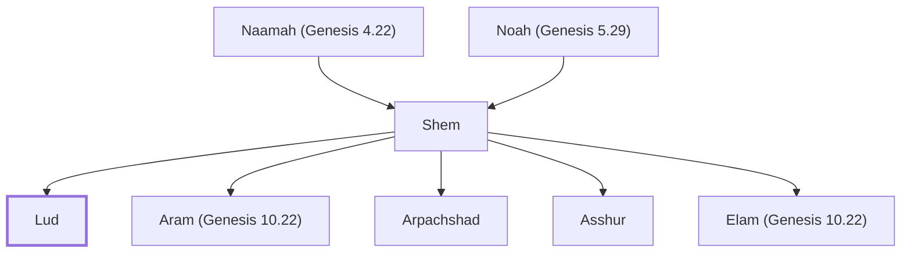

# Lud

Son of Shem; progenitor of the Lydians

**Original-language names:** לוּד (H3865)

## When

- **Placed around:** [[connections/timeline/7th century BC|698 BC]] *(Ussher: the median date of the passages naming them)*

## Family

- **Father:** [[connections/people/Shem|Shem]]
- **Brothers and sisters:** [[connections/people/Aram (Genesis 10.22)|Aram (Genesis 10.22)]], [[connections/people/Arpachshad|Arpachshad]], [[connections/people/Asshur|Asshur]], [[connections/people/Elam (Genesis 10.22)|Elam (Genesis 10.22)]]
- **Tribe or nation:** Early Patriarch

**Line of descent** (12 generations, father to son): [[connections/people/Adam|Adam]] → [[connections/people/Seth|Seth]] → [[connections/people/Enosh|Enosh]] → [[connections/people/Kenan|Kenan]] → [[connections/people/Mahalalel (Genesis 5.12)|Mahalalel (Genesis 5.12)]] → [[connections/people/Jared|Jared]] → [[connections/people/Enoch (Genesis 5.18)|Enoch (Genesis 5.18)]] → [[connections/people/Methuselah|Methuselah]] → [[connections/people/Lamech (Genesis 5.25)|Lamech (Genesis 5.25)]] → [[connections/people/Noah (Genesis 5.29)|Noah (Genesis 5.29)]] → [[connections/people/Shem|Shem]] → **Lud**

**Family group:** [[connections/genealogy/Family of Adam|Family of Adam]], generation 12

## Appears in

[[connections/chapters/01-genesis/Genesis 10|Genesis 10]] · [[connections/chapters/13-1-chronicles/1 Chronicles 1|1 Chronicles 1]] · [[connections/chapters/23-isaiah/Isaiah 66|Isaiah 66]] · [[connections/chapters/26-ezekiel/Ezekiel 27|Ezekiel 27]] · [[connections/chapters/26-ezekiel/Ezekiel 30|Ezekiel 30]]

## Appears in the same verse as

[[connections/places/Libya|Libya (3)]] · [[connections/people/Aram (Genesis 10.22)|Aram (Genesis 10.22) (2)]] · [[connections/people/Arpachshad|Arpachshad (2)]] · [[connections/people/Asshur|Asshur (2)]] · [[connections/people/Elam (Genesis 10.22)|Elam (Genesis 10.22) (2)]] · [[connections/people/Shem|Shem (2)]] · [[connections/people/Gether|Gether]] · [[connections/people/Hul|Hul]] · [[connections/people/Mash|Mash]] · [[connections/people/Uz (Genesis 10.23)|Uz (Genesis 10.23)]] · [[connections/places/Arabia|Arabia]] · [[connections/places/Cush|Cush]] · [[connections/places/Greece|Greece]] · [[connections/places/Persia|Persia]] · [[connections/places/Tarshish|Tarshish]] · [[connections/places/Tubal|Tubal]]
