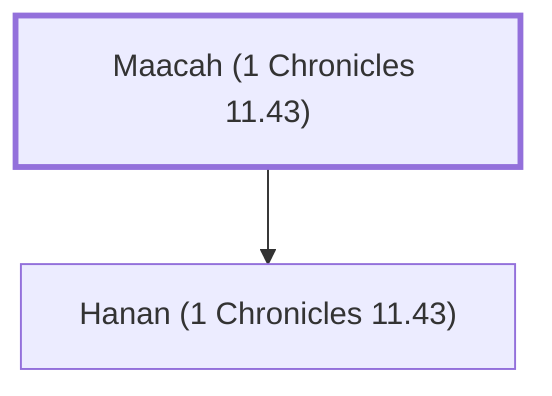

# Maacah (1 Chronicles 11.43)

Father of Hanan, one of David's mighty men

**Original-language names:** מַעֲכָה (H4601)

## When

- **Placed around:** [[connections/timeline/11th century BC|1055 BC]] *(Ussher: the median date of the passages naming them)*

## Family

- **Children:** [[connections/people/Hanan (1 Chronicles 11.43)|Hanan (1 Chronicles 11.43)]]

**Family group:** [[connections/genealogy/Family of Maacah (1 Chronicles 11.43)|Family of Maacah (1 Chronicles 11.43)]], generation 1

## Appears in

[[connections/chapters/13-1-chronicles/1 Chronicles 11|1 Chronicles 11]]

## Appears in the same verse as

[[connections/people/Hanan (1 Chronicles 11.43)|Hanan (1 Chronicles 11.43)]] · [[connections/people/Joshaphat (1 Chronicles 11.43)|Joshaphat (1 Chronicles 11.43)]]
