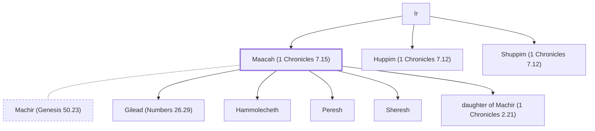

# Maacah (1 Chronicles 7.15)

Sister of Huppim and Shuppim; mother of Peresh and Sheresh

**Original-language names:** מַעֲכָה (H4601)

## Family

- **Father:** [[connections/people/Ir|Ir]]
- **Brothers and sisters:** [[connections/people/Huppim (1 Chronicles 7.12)|Huppim (1 Chronicles 7.12)]], [[connections/people/Shuppim (1 Chronicles 7.12)|Shuppim (1 Chronicles 7.12)]]
- **Spouses:** [[connections/people/Machir (Genesis 50.23)|Machir (Genesis 50.23)]]
- **Children:** [[connections/people/Gilead (Numbers 26.29)|Gilead (Numbers 26.29) (uncertain)]], [[connections/people/Hammolecheth|Hammolecheth (uncertain)]], [[connections/people/Peresh|Peresh]], [[connections/people/Sheresh|Sheresh]], [[connections/people/daughter of Machir (1 Chronicles 2.21)|daughter of Machir (1 Chronicles 2.21) (uncertain)]]
- **Tribe or nation:** Tribe of Manasseh(?)

**Family group:** [[connections/genealogy/Family of Adam|Family of Adam]], generation 2

## Appears in

[[connections/chapters/13-1-chronicles/1 Chronicles 7|1 Chronicles 7 (2)]]

## Appears in the same verse as

[[connections/people/Machir (Genesis 50.23)|Machir (Genesis 50.23) (2)]] · [[connections/people/Huppim (1 Chronicles 7.12)|Huppim (1 Chronicles 7.12)]] · [[connections/people/Peresh|Peresh]] · [[connections/people/Rakem|Rakem]] · [[connections/people/Sheresh|Sheresh]] · [[connections/people/Shuppim (1 Chronicles 7.12)|Shuppim (1 Chronicles 7.12)]] · [[connections/people/Ulam (1 Chronicles 7.16)|Ulam (1 Chronicles 7.16)]] · [[connections/people/Zelophehad|Zelophehad]]
