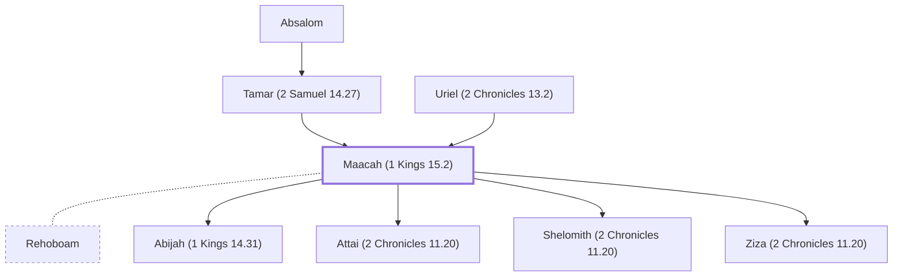

# Maacah (1 Kings 15.2)

Daughter of Abishalom; wife of Rehoboam; mother of Abijah

**Also called:** Micaiah

**Original-language names:** מַעֲכָה (H4601) · מִיכָיָ֫הוּ (H4322)

## When

- **Placed around:** [[connections/timeline/10th century BC|958 BC]] *(Ussher: the median date of the passages naming them)*

## Family

- **Father:** [[connections/people/Uriel (2 Chronicles 13.2)|Uriel (2 Chronicles 13.2)]]
- **Mother:** [[connections/people/Tamar (2 Samuel 14.27)|Tamar (2 Samuel 14.27)]]
- **Spouses:** [[connections/people/Rehoboam|Rehoboam]]
- **Children:** [[connections/people/Abijah (1 Kings 14.31)|Abijah (1 Kings 14.31)]], [[connections/people/Attai (2 Chronicles 11.20)|Attai (2 Chronicles 11.20)]], [[connections/people/Shelomith (2 Chronicles 11.20)|Shelomith (2 Chronicles 11.20)]], [[connections/people/Ziza (2 Chronicles 11.20)|Ziza (2 Chronicles 11.20)]]
- **Tribe or nation:** Tribe of Judah

**Family group:** [[connections/genealogy/Family of Adam|Family of Adam]], generation 39

## Appears in

[[connections/chapters/11-1-kings/1 Kings 15|1 Kings 15 (3)]] · [[connections/chapters/14-2-chronicles/2 Chronicles 11|2 Chronicles 11 (3)]] · [[connections/chapters/14-2-chronicles/2 Chronicles 13|2 Chronicles 13]] · [[connections/chapters/14-2-chronicles/2 Chronicles 15|2 Chronicles 15]]

## Appears in the same verse as

[[connections/people/Absalom|Absalom (4)]] · [[connections/people/Abijah (1 Kings 14.31)|Abijah (1 Kings 14.31) (3)]] · [[connections/places/Jerusalem|Jerusalem (3)]] · [[connections/people/Asa (1 Kings 15.8)|Asa (1 Kings 15.8) (2)]] · [[connections/people/Rehoboam|Rehoboam (2)]] · [[connections/places/Kidron|Kidron (2)]] · [[connections/people/Attai (2 Chronicles 11.20)|Attai (2 Chronicles 11.20)]] · [[connections/people/Jeroboam (1 Kings 11.26)|Jeroboam (1 Kings 11.26)]] · [[connections/people/Shelomith (2 Chronicles 11.20)|Shelomith (2 Chronicles 11.20)]] · [[connections/people/Uriel (2 Chronicles 13.2)|Uriel (2 Chronicles 13.2)]] · [[connections/people/Ziza (2 Chronicles 11.20)|Ziza (2 Chronicles 11.20)]] · [[connections/places/Gibeah (Joshua 15.57)|Gibeah (Joshua 15.57)]]
