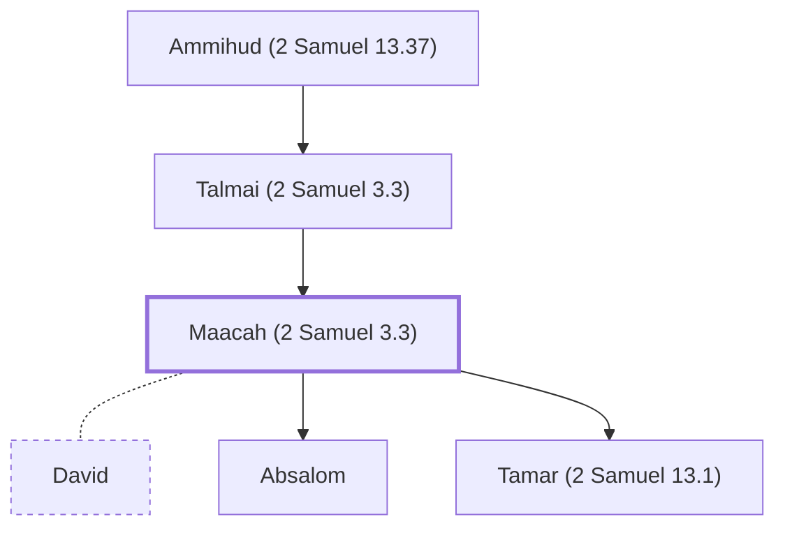

# Maacah (2 Samuel 3.3)

Daughter of Talmai; wife of David; mother of Absalom

**Original-language names:** מַעֲכָה (H4601)

## When

- **Placed around:** [[connections/timeline/11th century BC|1048 BC]] *(Ussher: the median date of the passages naming them)*

## Family

- **Father:** [[connections/people/Talmai (2 Samuel 3.3)|Talmai (2 Samuel 3.3)]]
- **Spouses:** [[connections/people/David|David]]
- **Children:** [[connections/people/Absalom|Absalom]], [[connections/people/Tamar (2 Samuel 13.1)|Tamar (2 Samuel 13.1)]]

**Line of descent** (3 generations, father to son): [[connections/people/Ammihud (2 Samuel 13.37)|Ammihud (2 Samuel 13.37)]] → [[connections/people/Talmai (2 Samuel 3.3)|Talmai (2 Samuel 3.3)]] → **Maacah (2 Samuel 3.3)**

**Family group:** [[connections/genealogy/Family of Adam|Family of Adam]], generation 3

## Appears in

[[connections/chapters/10-2-samuel/2 Samuel 3|2 Samuel 3]] · [[connections/chapters/13-1-chronicles/1 Chronicles 3|1 Chronicles 3]]

## Appears in the same verse as

[[connections/people/Absalom|Absalom (2)]] · [[connections/people/Talmai (2 Samuel 3.3)|Talmai (2 Samuel 3.3) (2)]] · [[connections/places/Geshur|Geshur (2)]] · [[connections/people/Abigail (1 Samuel 25.3)|Abigail (1 Samuel 25.3)]] · [[connections/people/Adonijah (2 Samuel 3.4)|Adonijah (2 Samuel 3.4)]] · [[connections/people/Chileab|Chileab]] · [[connections/people/Haggith|Haggith]] · [[connections/people/Nabal|Nabal]]
