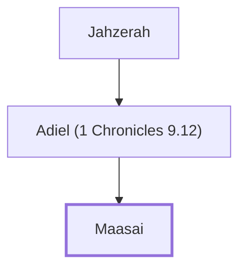

# Maasai

Priest during the time of David and Nehemiah

**Also called:** Amashsai

**Original-language names:** מַעֲשַׂי (H4640) · עֲמַשְׁסַי (H6023)

## When

- **Placed around:** [[connections/timeline/5th century BC|445 BC]] *(Ussher: the median date of the passages naming them)*

## Family

- **Father:** [[connections/people/Adiel (1 Chronicles 9.12)|Adiel (1 Chronicles 9.12)]]
- **Tribe or nation:** Tribe of Levi

**Line of descent** (6 generations, father to son): [[connections/people/Immer (1 Chronicles 9.12)|Immer (1 Chronicles 9.12)]] → [[connections/people/Meshillemith|Meshillemith]] → [[connections/people/Meshullam (1 Chronicles 9.12)|Meshullam (1 Chronicles 9.12)]] → [[connections/people/Jahzerah|Jahzerah]] → [[connections/people/Adiel (1 Chronicles 9.12)|Adiel (1 Chronicles 9.12)]] → **Maasai**

**Family group:** [[connections/genealogy/Family of Immer (1 Chronicles 9.12)|Family of Immer (1 Chronicles 9.12)]], generation 6

## Appears in

[[connections/chapters/13-1-chronicles/1 Chronicles 9|1 Chronicles 9]] · [[connections/chapters/16-nehemiah/Nehemiah 11|Nehemiah 11]]

## Appears in the same verse as

[[connections/people/Adiel (1 Chronicles 9.12)|Adiel (1 Chronicles 9.12) (2)]] · [[connections/people/Immer (1 Chronicles 9.12)|Immer (1 Chronicles 9.12) (2)]] · [[connections/people/Meshillemith|Meshillemith (2)]] · [[connections/people/Meshullam (1 Chronicles 9.12)|Meshullam (1 Chronicles 9.12) (2)]] · [[connections/people/Adaiah (1 Chronicles 9.12)|Adaiah (1 Chronicles 9.12)]] · [[connections/people/Jahzerah|Jahzerah]] · [[connections/people/Jeroham (1 Chronicles 9.12)|Jeroham (1 Chronicles 9.12)]] · [[connections/people/Malchijah (1 Chronicles 9.12)|Malchijah (1 Chronicles 9.12)]] · [[connections/people/Pashhur (1 Chronicles 9.12)|Pashhur (1 Chronicles 9.12)]]
