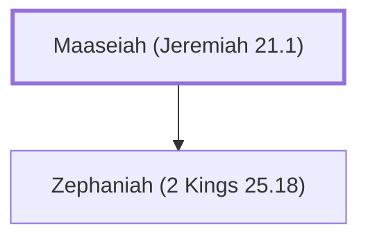

# Maaseiah (Jeremiah 21.1)

Priest during the reigns of Zedekiah and Jehoiakim

**Original-language names:** מַעֲשֵׂיָהוּ (H4641)

## When

- **Placed around:** [[connections/timeline/6th century BC|598 BC]] *(Ussher: the median date of the passages naming them)*

## Family

- **Children:** [[connections/people/Zephaniah (2 Kings 25.18)|Zephaniah (2 Kings 25.18)]]

**Family group:** [[connections/genealogy/Family of Maaseiah (Jeremiah 21.1)|Family of Maaseiah (Jeremiah 21.1)]], generation 1

## Appears in

[[connections/chapters/24-jeremiah/Jeremiah 21|Jeremiah 21]] · [[connections/chapters/24-jeremiah/Jeremiah 29|Jeremiah 29]] · [[connections/chapters/24-jeremiah/Jeremiah 37|Jeremiah 37]]

## Appears in the same verse as

[[connections/people/Zephaniah (2 Kings 25.18)|Zephaniah (2 Kings 25.18) (3)]] · [[connections/people/Jeremiah (2 Chronicles 35.25)|Jeremiah (2 Chronicles 35.25) (2)]] · [[connections/people/Zedekiah (2 Kings 24.17)|Zedekiah (2 Kings 24.17) (2)]] · [[connections/people/Israel|Israel]] · [[connections/people/Jehucal|Jehucal]] · [[connections/people/Malchiah|Malchiah]] · [[connections/people/Pashhur (Jeremiah 21.1)|Pashhur (Jeremiah 21.1)]] · [[connections/people/Shelemiah (Jeremiah 37.3)|Shelemiah (Jeremiah 37.3)]] · [[connections/places/Jerusalem|Jerusalem]]
