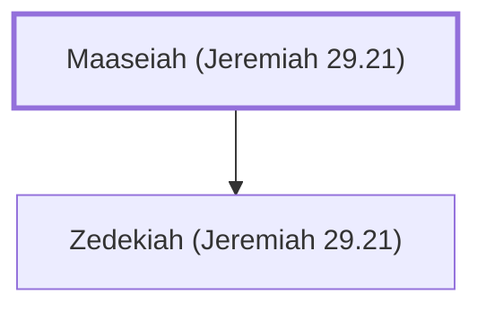

# Maaseiah (Jeremiah 29.21)

False prophet during the Babylonian exile

**Original-language names:** מַעֲשֵׂיָהוּ (H4641)

## When

- **Placed around:** [[connections/timeline/6th century BC|599 BC]] *(Ussher: the median date of the passages naming them)*

## Family

- **Children:** [[connections/people/Zedekiah (Jeremiah 29.21)|Zedekiah (Jeremiah 29.21)]]

**Family group:** [[connections/genealogy/Family of Maaseiah (Jeremiah 29.21)|Family of Maaseiah (Jeremiah 29.21)]], generation 1

## Appears in

[[connections/chapters/24-jeremiah/Jeremiah 29|Jeremiah 29]]

## Appears in the same verse as

[[connections/people/Ahab (Jeremiah 29.21)|Ahab (Jeremiah 29.21)]] · [[connections/people/Israel|Israel]] · [[connections/people/Kolaiah (Jeremiah 29.21)|Kolaiah (Jeremiah 29.21)]] · [[connections/people/Nebuchadnezzar|Nebuchadnezzar]] · [[connections/people/Zedekiah (Jeremiah 29.21)|Zedekiah (Jeremiah 29.21)]] · [[connections/places/Babylon|Babylon]]
