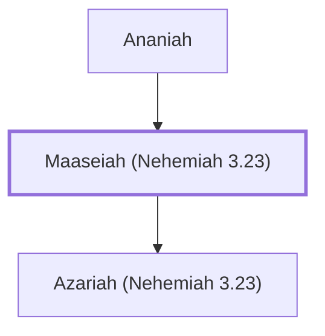

# Maaseiah (Nehemiah 3.23)

Israelite who repaired a section of Jerusalem's wall

**Original-language names:** מַעֲשֵׂיָהוּ (H4641)

## When

- **Placed around:** [[connections/timeline/5th century BC|445 BC]] *(Ussher: the median date of the passages naming them)*

## Family

- **Father:** [[connections/people/Ananiah|Ananiah]]
- **Children:** [[connections/people/Azariah (Nehemiah 3.23)|Azariah (Nehemiah 3.23)]]

**Family group:** [[connections/genealogy/Family of Ananiah|Family of Ananiah]], generation 2

## Appears in

[[connections/chapters/16-nehemiah/Nehemiah 3|Nehemiah 3]]

## Appears in the same verse as

[[connections/people/Ananiah|Ananiah]] · [[connections/people/Azariah (Nehemiah 3.23)|Azariah (Nehemiah 3.23)]] · [[connections/people/Benjamin (Nehemiah 3.23)|Benjamin (Nehemiah 3.23)]] · [[connections/people/Hasshub (Nehemiah 3.23)|Hasshub (Nehemiah 3.23)]]
