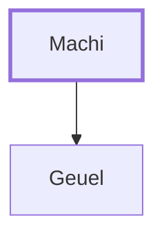

# Machi

Father of Geuel, from the tribe of Gad

**Original-language names:** מָכִי (H4352)

## When

- **Placed around:** [[connections/timeline/15th century BC|1490 BC]] *(Ussher: the median date of the passages naming them)*

## Family

- **Children:** [[connections/people/Geuel|Geuel]]
- **Tribe or nation:** Tribe of Gad

**Family group:** [[connections/genealogy/Family of Machi|Family of Machi]], generation 1

## Appears in

[[connections/chapters/04-numbers/Numbers 13|Numbers 13]]

## Appears in the same verse as

[[connections/people/Gad (Genesis 30.11)|Gad (Genesis 30.11)]] · [[connections/people/Geuel|Geuel]]
