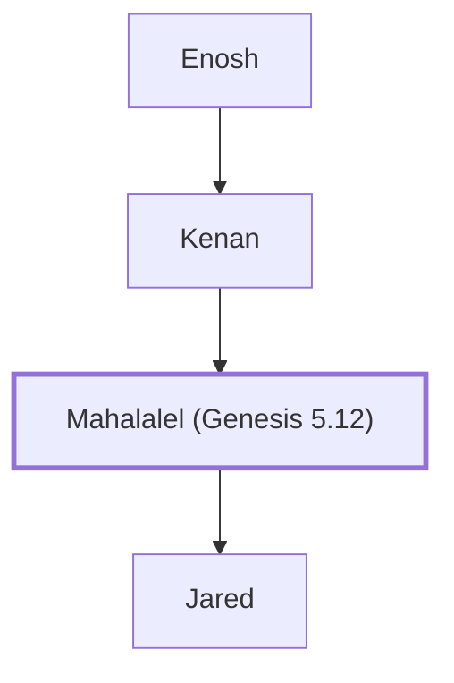

# Mahalalel (Genesis 5.12)

Descendant of Seth; ancestor of Noah

**Original-language names:** מַהֲלַלְאֵל (H4111) · Μαλελεήλ (G3121)

## When

- **Placed around:** [[connections/timeline/36th century BC|3544 BC]] *(Ussher: the median date of the passages naming them)*

## Family

- **Father:** [[connections/people/Kenan|Kenan]]
- **Children:** [[connections/people/Jared|Jared]]
- **Tribe or nation:** Early Patriarch

**Line of descent** (5 generations, father to son): [[connections/people/Adam|Adam]] → [[connections/people/Seth|Seth]] → [[connections/people/Enosh|Enosh]] → [[connections/people/Kenan|Kenan]] → **Mahalalel (Genesis 5.12)**

**Family group:** [[connections/genealogy/Family of Adam|Family of Adam]], generation 5

## Appears in

[[connections/chapters/01-genesis/Genesis 5|Genesis 5 (5)]] · [[connections/chapters/13-1-chronicles/1 Chronicles 1|1 Chronicles 1]] · [[connections/chapters/42-luke/Luke 3|Luke 3]]

## Appears in the same verse as

[[connections/people/Jared|Jared (4)]] · [[connections/people/Kenan|Kenan (4)]] · [[connections/people/Enoch (Genesis 5.18)|Enoch (Genesis 5.18)]] · [[connections/people/Methuselah|Methuselah]]
