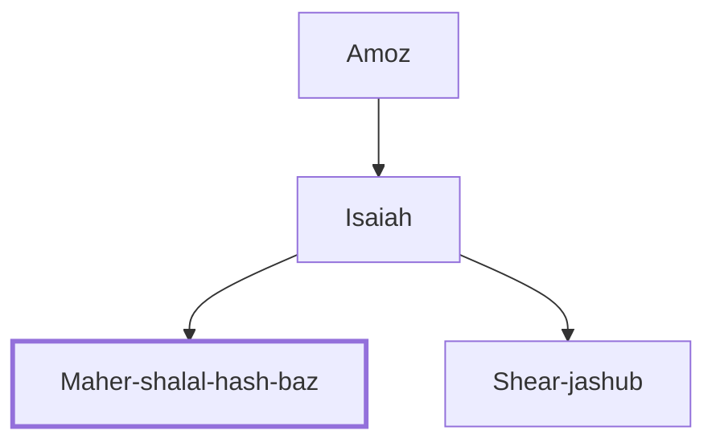

# Maher-shalal-hash-baz

Symbolic name given to Isaiah's son, meaning "swift is booty, speedy is prey."

**Original-language names:** מַהֵר שָׁלָל חָשׁ בַּז (H4122)

## Family

- **Father:** [[connections/people/Isaiah|Isaiah]]
- **Brothers and sisters:** [[connections/people/Shear-jashub|Shear-jashub]]

**Line of descent** (3 generations, father to son): [[connections/people/Amoz|Amoz]] → [[connections/people/Isaiah|Isaiah]] → **Maher-shalal-hash-baz**

**Family group:** [[connections/genealogy/Family of Amoz|Family of Amoz]], generation 3

## Appears in

[[connections/chapters/23-isaiah/Isaiah 8|Isaiah 8 (2)]]
