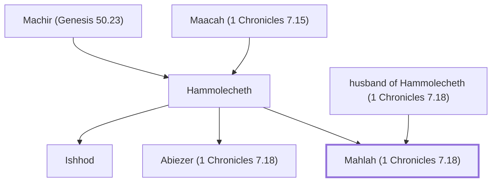

# Mahlah (1 Chronicles 7.18)

Daughter of Zelophehad's sister.

**Original-language names:** מַחְלָה (H4244)

## Family

- **Father:** [[connections/people/husband of Hammolecheth (1 Chronicles 7.18)|husband of Hammolecheth (1 Chronicles 7.18)]]
- **Mother:** [[connections/people/Hammolecheth|Hammolecheth]]
- **Brothers and sisters:** [[connections/people/Abiezer (1 Chronicles 7.18)|Abiezer (1 Chronicles 7.18)]], [[connections/people/Ishhod|Ishhod]]
- **Tribe or nation:** Tribe of Manasseh

**Family group:** [[connections/genealogy/Family of Adam|Family of Adam]], generation 30

## Appears in

[[connections/chapters/13-1-chronicles/1 Chronicles 7|1 Chronicles 7]]

## Appears in the same verse as

[[connections/people/Abiezer (1 Chronicles 7.18)|Abiezer (1 Chronicles 7.18)]] · [[connections/people/Hammolecheth|Hammolecheth]] · [[connections/people/Ishhod|Ishhod]]
