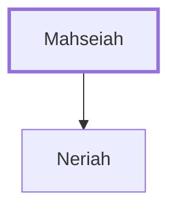

# Mahseiah

Grandfather of Baruch, Jeremiah's scribe.

**Original-language names:** מַחְסֵיָה (H4271)

## When

- **Placed around:** [[connections/timeline/6th century BC|589 BC]] *(Ussher: the median date of the passages naming them)*

## Family

- **Children:** [[connections/people/Neriah|Neriah]]

**Family group:** [[connections/genealogy/Family of Mahseiah|Family of Mahseiah]], generation 1

## Appears in

[[connections/chapters/24-jeremiah/Jeremiah 32|Jeremiah 32]] · [[connections/chapters/24-jeremiah/Jeremiah 51|Jeremiah 51]]

## Appears in the same verse as

[[connections/people/Neriah|Neriah (2)]] · [[connections/people/Baruch (Jeremiah 32.12)|Baruch (Jeremiah 32.12)]] · [[connections/people/Hanamel|Hanamel]] · [[connections/people/Jeremiah (2 Chronicles 35.25)|Jeremiah (2 Chronicles 35.25)]] · [[connections/people/Judah (Genesis 29.35)|Judah (Genesis 29.35)]] · [[connections/people/Seraiah (Jeremiah 51.59)|Seraiah (Jeremiah 51.59)]] · [[connections/people/Zedekiah (2 Kings 24.17)|Zedekiah (2 Kings 24.17)]] · [[connections/places/Babylon|Babylon]]
