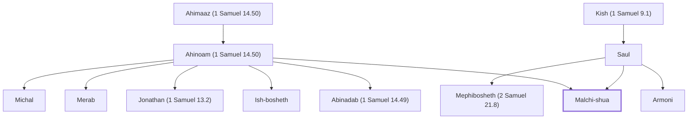

# Malchi-shua

Son of King Saul, killed in battle against the Philistines.

**Original-language names:** מַלְכִּישׁוּעַ (H4444)

## When

- **Placed around:** [[connections/timeline/11th century BC|1056 BC]] *(Ussher: the median date of the passages naming them)*

## Family

- **Father:** [[connections/people/Saul|Saul]]
- **Mother:** [[connections/people/Ahinoam (1 Samuel 14.50)|Ahinoam (1 Samuel 14.50)]]
- **Brothers and sisters:** [[connections/people/Abinadab (1 Samuel 14.49)|Abinadab (1 Samuel 14.49)]], [[connections/people/Armoni|Armoni]], [[connections/people/Ish-bosheth|Ish-bosheth]], [[connections/people/Jonathan (1 Samuel 13.2)|Jonathan (1 Samuel 13.2)]], [[connections/people/Mephibosheth (2 Samuel 21.8)|Mephibosheth (2 Samuel 21.8)]], [[connections/people/Merab|Merab]], [[connections/people/Michal|Michal]]
- **Tribe or nation:** Tribe of Benjamin

**Line of descent** (7 generations, father to son): [[connections/people/Aphiah|Aphiah]] → [[connections/people/Becorath|Becorath]] → [[connections/people/Zeror|Zeror]] → [[connections/people/Abiel|Abiel]] → [[connections/people/Kish (1 Samuel 9.1)|Kish (1 Samuel 9.1)]] → [[connections/people/Saul|Saul]] → **Malchi-shua**

**Family group:** [[connections/genealogy/Family of Aphiah|Family of Aphiah]], generation 7

## Appears in

[[connections/chapters/09-1-samuel/1 Samuel 14|1 Samuel 14]] · [[connections/chapters/09-1-samuel/1 Samuel 31|1 Samuel 31]] · [[connections/chapters/13-1-chronicles/1 Chronicles 8|1 Chronicles 8]] · [[connections/chapters/13-1-chronicles/1 Chronicles 9|1 Chronicles 9]] · [[connections/chapters/13-1-chronicles/1 Chronicles 10|1 Chronicles 10]]

## Appears in the same verse as

[[connections/people/Abinadab (1 Samuel 14.49)|Abinadab (1 Samuel 14.49) (5)]] · [[connections/people/Jonathan (1 Samuel 13.2)|Jonathan (1 Samuel 13.2) (5)]] · [[connections/people/Saul|Saul (5)]] · [[connections/people/Abiel|Abiel (2)]] · [[connections/people/Ish-bosheth|Ish-bosheth (2)]] · [[connections/people/Kish (1 Samuel 9.1)|Kish (1 Samuel 9.1) (2)]] · [[connections/people/Merab|Merab]] · [[connections/people/Michal|Michal]]
