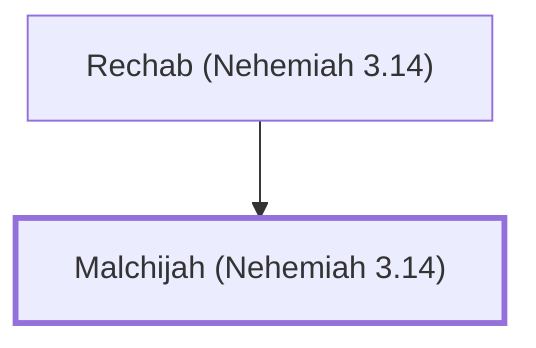

# Malchijah (Nehemiah 3.14)

Son of Rechab, repaired the Dung Gate in Jerusalem.

**Original-language names:** מַלְכִּיָּהוּ (H4441)

## When

- **Placed around:** [[connections/timeline/5th century BC|445 BC]] *(Ussher: the median date of the passages naming them)*

## Family

- **Father:** [[connections/people/Rechab (Nehemiah 3.14)|Rechab (Nehemiah 3.14)]]

**Family group:** [[connections/genealogy/Family of Rechab (Nehemiah 3.14)|Family of Rechab (Nehemiah 3.14)]], generation 2

## Appears in

[[connections/chapters/16-nehemiah/Nehemiah 3|Nehemiah 3]]

## Appears in the same verse as

[[connections/people/Rechab (Nehemiah 3.14)|Rechab (Nehemiah 3.14)]] · [[connections/places/Beth-haccherem|Beth-haccherem]] · [[connections/places/Dung Gate|Dung Gate]]
