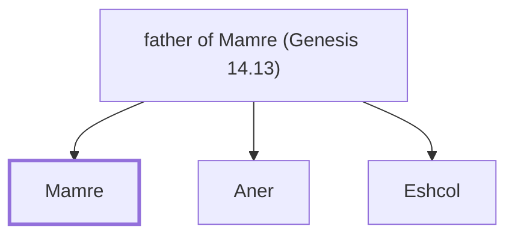

# Mamre

Amorite, ally of Abraham.

**Original-language names:** מַמְרֵא (H4471)

## When

- **Placed around:** [[connections/timeline/20th century BC|1913 BC]] *(Ussher: the median date of the passages naming them)*

## Family

- **Father:** [[connections/people/father of Mamre (Genesis 14.13)|father of Mamre (Genesis 14.13)]]
- **Brothers and sisters:** [[connections/people/Aner|Aner]], [[connections/people/Eshcol|Eshcol]]

**Family group:** [[connections/genealogy/Family of father of Mamre (Genesis 14.13)|Family of father of Mamre (Genesis 14.13)]], generation 2

## Appears in

[[connections/chapters/01-genesis/Genesis 14|Genesis 14]]

## Appears in the same verse as

[[connections/people/Abraham|Abraham]] · [[connections/people/Aner|Aner]] · [[connections/people/Eshcol|Eshcol]] · [[connections/places/Mamre|Mamre]]
