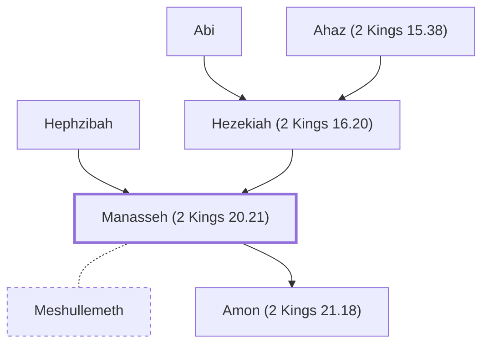

# Manasseh (2 Kings 20.21)

King of Judah, son of Hezekiah.

**Original-language names:** מְנַשֶּׁה (H4519) · Μανασσῆς (G3128)

## When

- **Lived:** [[connections/timeline/8th century BC|709 BC]] – [[connections/timeline/7th century BC|642 BC]] *(Jones)*
- **Placed around:** [[connections/timeline/7th century BC|693 BC]] *(Ussher: the median date of the passages naming them)*

## Family

- **Father:** [[connections/people/Hezekiah (2 Kings 16.20)|Hezekiah (2 Kings 16.20)]]
- **Mother:** [[connections/people/Hephzibah|Hephzibah]]
- **Spouses:** [[connections/people/Meshullemeth|Meshullemeth]]
- **Children:** [[connections/people/Amon (2 Kings 21.18)|Amon (2 Kings 21.18)]]
- **Tribe or nation:** Tribe of Judah

**Line of descent** (48 generations, father to son): [[connections/people/Adam|Adam]] → [[connections/people/Seth|Seth]] → [[connections/people/Enosh|Enosh]] → [[connections/people/Kenan|Kenan]] → [[connections/people/Mahalalel (Genesis 5.12)|Mahalalel (Genesis 5.12)]] → [[connections/people/Jared|Jared]] → [[connections/people/Enoch (Genesis 5.18)|Enoch (Genesis 5.18)]] → [[connections/people/Methuselah|Methuselah]] → [[connections/people/Lamech (Genesis 5.25)|Lamech (Genesis 5.25)]] → [[connections/people/Noah (Genesis 5.29)|Noah (Genesis 5.29)]] → [[connections/people/Shem|Shem]] → [[connections/people/Arpachshad|Arpachshad]] → [[connections/people/Cainan|Cainan]] → [[connections/people/Shelah (Genesis 10.24)|Shelah (Genesis 10.24)]] → [[connections/people/Eber (Genesis 10.21)|Eber (Genesis 10.21)]] → [[connections/people/Peleg|Peleg]] → [[connections/people/Reu|Reu]] → [[connections/people/Serug|Serug]] → [[connections/people/Nahor (Genesis 11.22)|Nahor (Genesis 11.22)]] → [[connections/people/Terah|Terah]] → [[connections/people/Abraham|Abraham]] → [[connections/people/Isaac|Isaac]] → [[connections/people/Israel|Israel]] → [[connections/people/Judah (Genesis 29.35)|Judah (Genesis 29.35)]] → [[connections/people/Perez|Perez]] → [[connections/people/Hezron (Genesis 46.12)|Hezron (Genesis 46.12)]] → [[connections/people/Ram (Ruth 4.19)|Ram (Ruth 4.19)]] → [[connections/people/Amminadab (Exodus 6.23)|Amminadab (Exodus 6.23)]] → [[connections/people/Nahshon|Nahshon]] → [[connections/people/Salmon|Salmon]] → [[connections/people/Boaz|Boaz]] → [[connections/people/Obed (Ruth 4.17)|Obed (Ruth 4.17)]] → [[connections/people/Jesse|Jesse]] → [[connections/people/David|David]] → [[connections/people/Solomon|Solomon]] → [[connections/people/Rehoboam|Rehoboam]] → [[connections/people/Abijah (1 Kings 14.31)|Abijah (1 Kings 14.31)]] → [[connections/people/Asa (1 Kings 15.8)|Asa (1 Kings 15.8)]] → [[connections/people/Jehoshaphat (1 Kings 15.24)|Jehoshaphat (1 Kings 15.24)]] → [[connections/people/Jehoram (1 Kings 22.51)|Jehoram (1 Kings 22.51)]] → [[connections/people/Ahaziah (2 Kings 8.24)|Ahaziah (2 Kings 8.24)]] → [[connections/people/Joash (2 Kings 11.2)|Joash (2 Kings 11.2)]] → [[connections/people/Amaziah (2 Kings 12.22)|Amaziah (2 Kings 12.22)]] → [[connections/people/Uzziah (2 Kings 14.21)|Uzziah (2 Kings 14.21)]] → [[connections/people/Jotham (2 Kings 15.5)|Jotham (2 Kings 15.5)]] → [[connections/people/Ahaz (2 Kings 15.38)|Ahaz (2 Kings 15.38)]] → [[connections/people/Hezekiah (2 Kings 16.20)|Hezekiah (2 Kings 16.20)]] → **Manasseh (2 Kings 20.21)**

**Family group:** [[connections/genealogy/Family of Adam|Family of Adam]], generation 48

## Events

- [[connections/timeline/7th century BC|697 BC]] · [[connections/events/Reign of Manasseh|Reign of Manasseh]]
- [[connections/timeline/7th century BC|642 BC]] · [[connections/events/Death of Manasseh|Death of Manasseh]]

## Appears in

[[connections/chapters/12-2-kings/2 Kings 20|2 Kings 20]] · [[connections/chapters/12-2-kings/2 Kings 21|2 Kings 21 (7)]] · [[connections/chapters/12-2-kings/2 Kings 23|2 Kings 23 (2)]] · [[connections/chapters/12-2-kings/2 Kings 24|2 Kings 24]] · [[connections/chapters/13-1-chronicles/1 Chronicles 3|1 Chronicles 3]] · [[connections/chapters/14-2-chronicles/2 Chronicles 32|2 Chronicles 32]] · [[connections/chapters/14-2-chronicles/2 Chronicles 33|2 Chronicles 33 (9)]] · [[connections/chapters/24-jeremiah/Jeremiah 15|Jeremiah 15]] · [[connections/chapters/40-matthew/Matthew 1|Matthew 1]]

## Appears in the same verse as

[[connections/people/Judah (Genesis 29.35)|Judah (Genesis 29.35) (9)]] · [[connections/places/Jerusalem|Jerusalem (7)]] · [[connections/people/Amon (2 Kings 21.18)|Amon (2 Kings 21.18) (5)]] · [[connections/people/Hezekiah (2 Kings 16.20)|Hezekiah (2 Kings 16.20) (5)]] · [[connections/people/Israel|Israel (3)]] · [[connections/people/Ahaz (2 Kings 15.38)|Ahaz (2 Kings 15.38) (2)]] · [[connections/people/David|David]] · [[connections/people/Hephzibah|Hephzibah]] · [[connections/people/Josiah (1 Kings 13.2)|Josiah (1 Kings 13.2)]] · [[connections/places/Assyria|Assyria]] · [[connections/places/Babylon|Babylon]] · [[connections/places/Kidron|Kidron]] · [[connections/places/Uzza|Uzza]]
