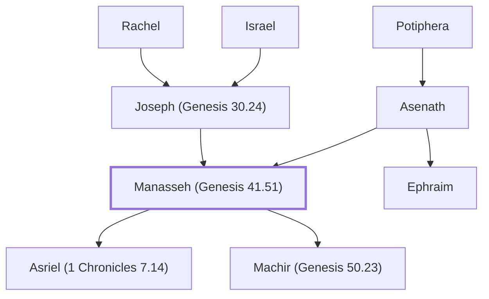

# Manasseh (Genesis 41.51)

Firstborn son of Joseph, blessed by Jacob.

**Original-language names:** מְנַשֶּׁה (H4519) · Μανασσῆς (G3128)

## When

- **Lived:** [[connections/timeline/18th century BC|1709 BC]] – ? *(Jones)*
- **Placed around:** [[connections/timeline/15th century BC|1443 BC]] *(Ussher: the median date of the passages naming them)*

## Family

- **Father:** [[connections/people/Joseph (Genesis 30.24)|Joseph (Genesis 30.24)]]
- **Mother:** [[connections/people/Asenath|Asenath]]
- **Brothers and sisters:** [[connections/people/Ephraim|Ephraim]]
- **Children:** [[connections/people/Asriel (1 Chronicles 7.14)|Asriel (1 Chronicles 7.14)]], [[connections/people/Machir (Genesis 50.23)|Machir (Genesis 50.23)]]
- **Tribe or nation:** Tribe of Manasseh

**Line of descent** (25 generations, father to son): [[connections/people/Adam|Adam]] → [[connections/people/Seth|Seth]] → [[connections/people/Enosh|Enosh]] → [[connections/people/Kenan|Kenan]] → [[connections/people/Mahalalel (Genesis 5.12)|Mahalalel (Genesis 5.12)]] → [[connections/people/Jared|Jared]] → [[connections/people/Enoch (Genesis 5.18)|Enoch (Genesis 5.18)]] → [[connections/people/Methuselah|Methuselah]] → [[connections/people/Lamech (Genesis 5.25)|Lamech (Genesis 5.25)]] → [[connections/people/Noah (Genesis 5.29)|Noah (Genesis 5.29)]] → [[connections/people/Shem|Shem]] → [[connections/people/Arpachshad|Arpachshad]] → [[connections/people/Cainan|Cainan]] → [[connections/people/Shelah (Genesis 10.24)|Shelah (Genesis 10.24)]] → [[connections/people/Eber (Genesis 10.21)|Eber (Genesis 10.21)]] → [[connections/people/Peleg|Peleg]] → [[connections/people/Reu|Reu]] → [[connections/people/Serug|Serug]] → [[connections/people/Nahor (Genesis 11.22)|Nahor (Genesis 11.22)]] → [[connections/people/Terah|Terah]] → [[connections/people/Abraham|Abraham]] → [[connections/people/Isaac|Isaac]] → [[connections/people/Israel|Israel]] → [[connections/people/Joseph (Genesis 30.24)|Joseph (Genesis 30.24)]] → **Manasseh (Genesis 41.51)**

**Family group:** [[connections/genealogy/Family of Adam|Family of Adam]], generation 25

## Appears in

[[connections/chapters/01-genesis/Genesis 41|Genesis 41]] · [[connections/chapters/01-genesis/Genesis 46|Genesis 46]] · [[connections/chapters/01-genesis/Genesis 48|Genesis 48 (6)]] · [[connections/chapters/01-genesis/Genesis 50|Genesis 50]] · [[connections/chapters/04-numbers/Numbers 1|Numbers 1 (3)]] · [[connections/chapters/04-numbers/Numbers 2|Numbers 2]] · [[connections/chapters/04-numbers/Numbers 7|Numbers 7]] · [[connections/chapters/04-numbers/Numbers 10|Numbers 10]] · [[connections/chapters/04-numbers/Numbers 13|Numbers 13]] · [[connections/chapters/04-numbers/Numbers 26|Numbers 26 (3)]] · [[connections/chapters/04-numbers/Numbers 27|Numbers 27]] · [[connections/chapters/04-numbers/Numbers 32|Numbers 32 (4)]] · [[connections/chapters/04-numbers/Numbers 34|Numbers 34 (2)]] · [[connections/chapters/04-numbers/Numbers 36|Numbers 36 (2)]] · [[connections/chapters/05-deuteronomy/Deuteronomy 3|Deuteronomy 3 (2)]] · [[connections/chapters/05-deuteronomy/Deuteronomy 33|Deuteronomy 33]] · [[connections/chapters/05-deuteronomy/Deuteronomy 34|Deuteronomy 34]] · [[connections/chapters/06-joshua/Joshua 1|Joshua 1]] · [[connections/chapters/06-joshua/Joshua 4|Joshua 4]] · [[connections/chapters/06-joshua/Joshua 12|Joshua 12]] · [[connections/chapters/06-joshua/Joshua 13|Joshua 13 (3)]] · [[connections/chapters/06-joshua/Joshua 14|Joshua 14]] · [[connections/chapters/06-joshua/Joshua 16|Joshua 16 (2)]] · [[connections/chapters/06-joshua/Joshua 17|Joshua 17 (12)]] · [[connections/chapters/06-joshua/Joshua 18|Joshua 18]] · [[connections/chapters/06-joshua/Joshua 20|Joshua 20]] · [[connections/chapters/06-joshua/Joshua 21|Joshua 21 (4)]] · [[connections/chapters/06-joshua/Joshua 22|Joshua 22 (10)]] · [[connections/chapters/07-judges/Judges 1|Judges 1]] · [[connections/chapters/07-judges/Judges 6|Judges 6 (2)]] · [[connections/chapters/07-judges/Judges 7|Judges 7]] · [[connections/chapters/07-judges/Judges 11|Judges 11]] · [[connections/chapters/07-judges/Judges 12|Judges 12]] · [[connections/chapters/11-1-kings/1 Kings 4|1 Kings 4]] · [[connections/chapters/13-1-chronicles/1 Chronicles 5|1 Chronicles 5 (3)]] · [[connections/chapters/13-1-chronicles/1 Chronicles 6|1 Chronicles 6 (4)]] · [[connections/chapters/13-1-chronicles/1 Chronicles 7|1 Chronicles 7 (3)]] · [[connections/chapters/13-1-chronicles/1 Chronicles 9|1 Chronicles 9]] · [[connections/chapters/13-1-chronicles/1 Chronicles 12|1 Chronicles 12 (4)]] · [[connections/chapters/13-1-chronicles/1 Chronicles 27|1 Chronicles 27 (2)]] · [[connections/chapters/14-2-chronicles/2 Chronicles 15|2 Chronicles 15]] · [[connections/chapters/14-2-chronicles/2 Chronicles 30|2 Chronicles 30 (4)]] · [[connections/chapters/14-2-chronicles/2 Chronicles 31|2 Chronicles 31]] · [[connections/chapters/14-2-chronicles/2 Chronicles 34|2 Chronicles 34 (2)]] · [[connections/chapters/19-psalms/Psalms 60|Psalms 60]] · [[connections/chapters/19-psalms/Psalms 80|Psalms 80]] · [[connections/chapters/19-psalms/Psalms 108|Psalms 108]] · [[connections/chapters/23-isaiah/Isaiah 9|Isaiah 9]] · [[connections/chapters/26-ezekiel/Ezekiel 48|Ezekiel 48 (2)]] · [[connections/chapters/66-revelation/Revelation 7|Revelation 7]]

## Appears in the same verse as

[[connections/people/Ephraim|Ephraim (35)]] · [[connections/people/Israel|Israel (20)]] · [[connections/people/Joseph (Genesis 30.24)|Joseph (Genesis 30.24) (20)]] · [[connections/places/Gilead|Gilead (18)]] · [[connections/people/Reuben|Reuben (14)]] · [[connections/places/Bashan|Bashan (14)]] · [[connections/people/Gad (Genesis 30.11)|Gad (Genesis 30.11) (13)]] · [[connections/people/Machir (Genesis 50.23)|Machir (Genesis 50.23) (11)]] · [[connections/people/Asher|Asher (9)]] · [[connections/people/Judah (Genesis 29.35)|Judah (Genesis 29.35) (9)]] · [[connections/people/Moses|Moses (9)]] · [[connections/people/Naphtali|Naphtali (8)]] · [[connections/places/Jordan|Jordan (7)]] · [[connections/people/Benjamin (Genesis 35.18)|Benjamin (Genesis 35.18) (6)]] · [[connections/people/Gilead (Numbers 26.29)|Gilead (Numbers 26.29) (6)]] · [[connections/people/Issachar (Genesis 30.18)|Issachar (Genesis 30.18) (5)]] · [[connections/places/Taanach|Taanach (5)]] · [[connections/people/Gamaliel (Numbers 1.10)|Gamaliel (Numbers 1.10) (4)]] · [[connections/people/Gershon|Gershon (4)]] · [[connections/people/Joshua (Exodus 17.9)|Joshua (Exodus 17.9) (4)]] · [[connections/people/Pedahzur|Pedahzur (4)]] · [[connections/people/Zebulun|Zebulun (4)]] · [[connections/places/Ibleam|Ibleam (4)]] · [[connections/places/Jerusalem|Jerusalem (4)]] · [[connections/people/Hepher (Numbers 26.32)|Hepher (Numbers 26.32) (3)]] · [[connections/people/Jair (Numbers 32.41)|Jair (Numbers 32.41) (3)]] · [[connections/people/Kohath|Kohath (3)]] · [[connections/people/Og|Og (3)]] · [[connections/people/Phinehas (Exodus 6.25)|Phinehas (Exodus 6.25) (3)]] · [[connections/people/Simeon (Genesis 29.33)|Simeon (Genesis 29.33) (3)]] · [[connections/places/Argob|Argob (3)]] · [[connections/places/Ashtaroth|Ashtaroth (3)]] · [[connections/places/Beth-shean|Beth-shean (3)]] · [[connections/places/Canaan|Canaan (3)]] · [[connections/places/Dor|Dor (3)]] · [[connections/places/Golan|Golan (3)]] · [[connections/places/Megiddo|Megiddo (3)]] · [[connections/places/Ramoth|Ramoth (3)]] · [[connections/people/David|David (2)]] · [[connections/people/Eleazar (Exodus 6.23)|Eleazar (Exodus 6.23) (2)]] · [[connections/people/Hezekiah (2 Kings 16.20)|Hezekiah (2 Kings 16.20) (2)]] · [[connections/people/Hoglah|Hoglah (2)]] · [[connections/people/Jephthah|Jephthah (2)]] · [[connections/people/Mahlah (Numbers 26.33)|Mahlah (Numbers 26.33) (2)]] · [[connections/people/Milcah (Numbers 26.33)|Milcah (Numbers 26.33) (2)]] · [[connections/people/Noah (Numbers 26.33)|Noah (Numbers 26.33) (2)]] · [[connections/people/Tirzah|Tirzah (2)]] · [[connections/people/Zelophehad|Zelophehad (2)]] · [[connections/places/Egypt|Egypt (2)]] · [[connections/places/Gilgal (Deuteronomy 11.30)|Gilgal (Deuteronomy 11.30) (2)]] · [[connections/places/Havvoth-jair|Havvoth-jair (2)]] · [[connections/places/Tappuah (Joshua 12.17)|Tappuah (Joshua 12.17) (2)]] · [[connections/people/Abiezer (Numbers 26.30)|Abiezer (Numbers 26.30)]] · [[connections/people/Abner|Abner]] · [[connections/people/Adnah (1 Chronicles 12.21)|Adnah (1 Chronicles 12.21)]] · [[connections/people/Ammihud (Numbers 1.10)|Ammihud (Numbers 1.10)]] · [[connections/people/Asenath|Asenath]] · [[connections/people/Asriel (1 Chronicles 7.14)|Asriel (1 Chronicles 7.14)]] · [[connections/people/Asriel (Numbers 26.31)|Asriel (Numbers 26.31)]] · [[connections/people/Azaziah (1 Chronicles 27.20)|Azaziah (1 Chronicles 27.20)]] · [[connections/people/Bedan|Bedan]] · [[connections/people/Ben-Geber|Ben-Geber]] · [[connections/people/Elihu (1 Chronicles 12.21)|Elihu (1 Chronicles 12.21)]] · [[connections/people/Elishama (Numbers 1.10)|Elishama (Numbers 1.10)]] · [[connections/people/Ephod|Ephod]] · [[connections/people/Gaddi|Gaddi]] · [[connections/people/Hanniel (Numbers 34.23)|Hanniel (Numbers 34.23)]] · [[connections/people/Helek|Helek]] · [[connections/people/Hilkiah (2 Kings 22.4)|Hilkiah (2 Kings 22.4)]] · [[connections/people/Hoshea (1 Chronicles 27.20)|Hoshea (1 Chronicles 27.20)]] · [[connections/people/Iddo (1 Chronicles 27.21)|Iddo (1 Chronicles 27.21)]] · [[connections/people/Jaasiel (1 Chronicles 27.21)|Jaasiel (1 Chronicles 27.21)]] · [[connections/people/Jediael (1 Chronicles 12.21)|Jediael (1 Chronicles 12.21)]] · [[connections/people/Joel (1 Chronicles 27.20)|Joel (1 Chronicles 27.20)]] · [[connections/people/Jozabad (1 Chronicles 12.21)|Jozabad (1 Chronicles 12.21)]] · [[connections/people/Jozabad (1 Chronicles 12.21)|Jozabad (1 Chronicles 12.21)]] · [[connections/people/Michael (1 Chronicles 12.21)|Michael (1 Chronicles 12.21)]] · [[connections/people/Pedaiah (1 Chronicles 27.20)|Pedaiah (1 Chronicles 27.20)]] · [[connections/people/Potiphera|Potiphera]] · [[connections/people/Saul|Saul]] · [[connections/people/Shechem (Numbers 26.31)|Shechem (Numbers 26.31)]] · [[connections/people/Shemida|Shemida]] · [[connections/people/Sihon|Sihon]] · [[connections/people/Susi|Susi]] · [[connections/people/Tiglath-pileser|Tiglath-pileser]] · [[connections/people/Ulam (1 Chronicles 7.16)|Ulam (1 Chronicles 7.16)]] · [[connections/people/Zechariah (1 Chronicles 27.21)|Zechariah (1 Chronicles 27.21)]] · [[connections/people/Zillethai (1 Chronicles 12.21)|Zillethai (1 Chronicles 12.21)]] · [[connections/places/Ammon|Ammon]] · [[connections/places/Assyria|Assyria]] · [[connections/places/Bezer|Bezer]] · [[connections/places/Dan|Dan]] · [[connections/places/Edrei|Edrei]] · [[connections/places/En-dor|En-dor]] · [[connections/places/Gozan|Gozan]] · [[connections/places/Habor|Habor]] · [[connections/places/Halah|Halah]] · [[connections/places/Hara|Hara]] · [[connections/places/Hermon Mount|Hermon Mount]] · [[connections/places/Jericho|Jericho]] · [[connections/places/Kanah (Joshua 16.8)|Kanah (Joshua 16.8)]] · [[connections/places/Michmethath|Michmethath]] · [[connections/places/Midian|Midian]] · [[connections/places/Naphath|Naphath]] · [[connections/places/On|On]] · [[connections/places/Shechem|Shechem]] · [[connections/places/Shiloh|Shiloh]] · [[connections/places/Ziklag|Ziklag]]
