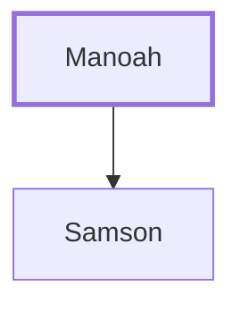

# Manoah

Father of Samson, from the tribe of Dan.

**Original-language names:** מָנוֹחַ (H4495)

## When

- **Placed around:** [[connections/timeline/12th century BC|1120 BC]] *(Ussher: the median date of the passages naming them)*

## Family

- **Children:** [[connections/people/Samson|Samson]]

**Family group:** [[connections/genealogy/Family of Manoah|Family of Manoah]], generation 1

## Appears in

[[connections/chapters/07-judges/Judges 13|Judges 13 (13)]] · [[connections/chapters/07-judges/Judges 16|Judges 16]]

## Appears in the same verse as

[[connections/places/Zorah|Zorah (2)]] · [[connections/people/Israel|Israel]] · [[connections/places/Dan|Dan]] · [[connections/places/Eshtaol|Eshtaol]]
