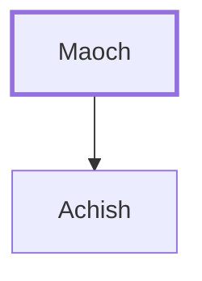

# Maoch

Father of Achish, king of Gath.

**Also called:** Maacah

**Original-language names:** מָעוֹךְ (H4582) · מַעֲכָה (H4601)

## When

- **Placed around:** [[connections/timeline/11th century BC|1011 BC]] *(Ussher: the median date of the passages naming them)*

## Family

- **Children:** [[connections/people/Achish|Achish]]

**Family group:** [[connections/genealogy/Family of Maoch|Family of Maoch]], generation 1

## Appears in

[[connections/chapters/09-1-samuel/1 Samuel 27|1 Samuel 27]] · [[connections/chapters/11-1-kings/1 Kings 2|1 Kings 2]]

## Appears in the same verse as

[[connections/people/Achish|Achish (2)]] · [[connections/places/Gath|Gath (2)]] · [[connections/people/David|David]] · [[connections/people/Shimei (2 Samuel 16.5)|Shimei (2 Samuel 16.5)]]
