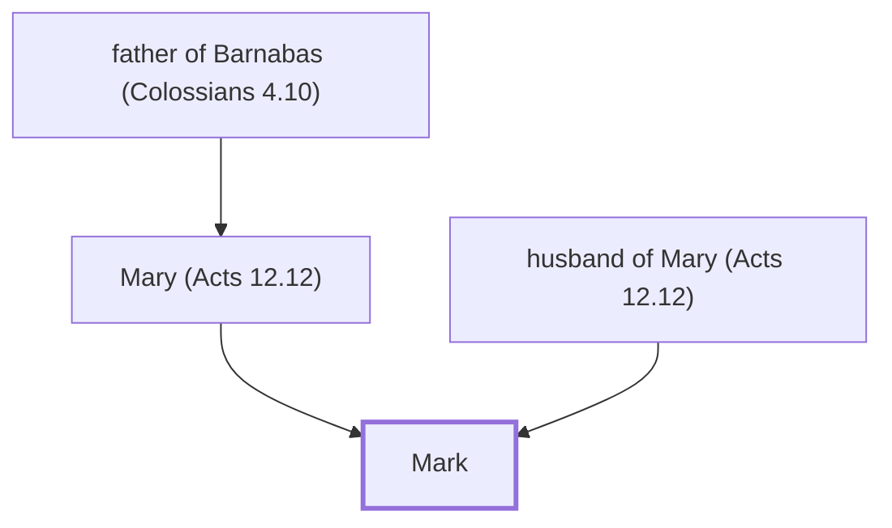

# Mark

Cousin of Barnabas, companion of Paul, author of Gospel.

**Also called:** John

**Original-language names:** Μάρκος (G3138) · Ἰωάννης (G2491)

## When

- **Placed around:** [[connections/timeline/1st century AD|AD 51]] *(Ussher: the median date of the passages naming them)*

## Family

- **Father:** [[connections/people/husband of Mary (Acts 12.12)|husband of Mary (Acts 12.12)]]
- **Mother:** [[connections/people/Mary (Acts 12.12)|Mary (Acts 12.12)]]
- **Tribe or nation:** Tribe of Levi

**Family group:** [[connections/genealogy/Family of father of Barnabas (Colossians 4.10)|Family of father of Barnabas (Colossians 4.10)]], generation 3

## Events

- [[connections/timeline/1st century AD|AD 45]] · [[connections/events/First missionary journey begins|First missionary journey begins]]
- [[connections/timeline/1st century AD|AD 45]] · [[connections/events/First Missionary Journey|First Missionary Journey]]
- [[connections/timeline/1st century AD|AD 45]] · [[connections/events/Barnabas and Saul go to Cyprus|Barnabas and Saul go to Cyprus]]
- [[connections/timeline/1st century AD|AD 45]] · [[connections/events/Mission to Antioch in Pisidia|Mission to Antioch in Pisidia]]
- [[connections/timeline/1st century AD|AD 46]] · [[connections/events/Second Missionary Journey|Second Missionary Journey]]
- [[connections/timeline/1st century AD|AD 47]] · [[connections/events/Paul and Barnabas part ways|Paul and Barnabas part ways]]

## Appears in

[[connections/chapters/44-acts/Acts 12|Acts 12 (2)]] · [[connections/chapters/44-acts/Acts 13|Acts 13 (2)]] · [[connections/chapters/44-acts/Acts 15|Acts 15 (2)]] · [[connections/chapters/51-colossians/Colossians 4|Colossians 4]] · [[connections/chapters/55-2-timothy/2 Timothy 4|2 Timothy 4]] · [[connections/chapters/57-philemon/Philemon 1|Philemon 1]] · [[connections/chapters/60-1-peter/1 Peter 5|1 Peter 5]]

## Appears in the same verse as

[[connections/people/Barnabas|Barnabas (4)]] · [[connections/people/Aristarchus|Aristarchus (2)]] · [[connections/people/Luke|Luke (2)]] · [[connections/people/Paul|Paul (2)]] · [[connections/places/Jerusalem|Jerusalem (2)]] · [[connections/people/Demas|Demas]] · [[connections/people/Mary (Acts 12.12)|Mary (Acts 12.12)]] · [[connections/places/Babylon|Babylon]] · [[connections/places/Cyprus|Cyprus]] · [[connections/places/Pamphylia|Pamphylia]] · [[connections/places/Paphos|Paphos]] · [[connections/places/Perga|Perga]] · [[connections/places/Salamis|Salamis]]
