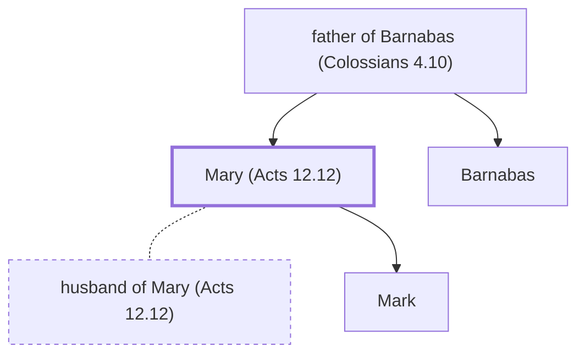

# Mary (Acts 12.12)

Mother of John Mark; hosted prayer meeting.

**Original-language names:** Μαρία (G3137)

## When

- **Placed around:** [[connections/timeline/1st century AD|AD 44]] *(Ussher: the median date of the passages naming them)*

## Family

- **Father:** [[connections/people/father of Barnabas (Colossians 4.10)|father of Barnabas (Colossians 4.10)]]
- **Brothers and sisters:** [[connections/people/Barnabas|Barnabas]]
- **Spouses:** [[connections/people/husband of Mary (Acts 12.12)|husband of Mary (Acts 12.12)]]
- **Children:** [[connections/people/Mark|Mark]]

**Family group:** [[connections/genealogy/Family of father of Barnabas (Colossians 4.10)|Family of father of Barnabas (Colossians 4.10)]], generation 2

## Events

- [[connections/timeline/1st century AD|AD 40]] · [[connections/events/An angel rescues Peter from prison|An angel rescues Peter from prison]]

## Appears in

[[connections/chapters/44-acts/Acts 12|Acts 12]]

## Appears in the same verse as

[[connections/people/Mark|Mark]]
