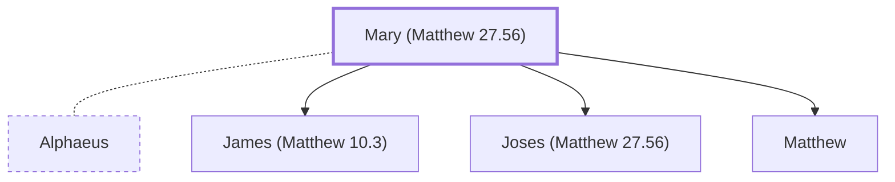

# Mary (Matthew 27.56)

Wife of Cleopas (or 'Alphaeus'), present at Jesus' crucifixion.

**Original-language names:** Μαρία (G3137)

## When

- **Placed around:** [[connections/timeline/1st century AD|AD 33]] *(Ussher: the median date of the passages naming them)*

## Family

- **Spouses:** [[connections/people/Alphaeus|Alphaeus (uncertain)]]
- **Children:** [[connections/people/James (Matthew 10.3)|James (Matthew 10.3) (uncertain)]], [[connections/people/Joses (Matthew 27.56)|Joses (Matthew 27.56)]], [[connections/people/Matthew|Matthew (uncertain)]]

**Family group:** [[connections/genealogy/Family of Adam|Family of Adam]], generation 68

## Events

- [[connections/timeline/1st century AD|AD 28]] · [[connections/events/Jesus' 2nd Tour of Galilee|Jesus' 2nd Tour of Galilee]]
- [[connections/timeline/1st century AD|AD 30]] · [[connections/events/Resurrection and Ascension|Resurrection and Ascension]]
- [[connections/timeline/1st century AD|AD 30]] · [[connections/events/Crucifixion and Burial|Crucifixion and Burial]]

## Appears in

[[connections/chapters/40-matthew/Matthew 27|Matthew 27 (2)]] · [[connections/chapters/40-matthew/Matthew 28|Matthew 28]] · [[connections/chapters/41-mark/Mark 15|Mark 15]] · [[connections/chapters/41-mark/Mark 16|Mark 16]] · [[connections/chapters/42-luke/Luke 24|Luke 24]] · [[connections/chapters/43-john/John 19|John 19]]

## Appears in the same verse as

[[connections/people/Mary Magdalene|Mary Magdalene (7)]] · [[connections/places/Magadan|Magadan (7)]] · [[connections/people/James (Matthew 10.3)|James (Matthew 10.3) (4)]] · [[connections/people/Joses (Matthew 27.56)|Joses (Matthew 27.56) (2)]] · [[connections/people/Salome|Salome (2)]] · [[connections/people/Alphaeus|Alphaeus]] · [[connections/people/Jesus|Jesus]] · [[connections/people/Joanna|Joanna]] · [[connections/people/Zebedee|Zebedee]]
