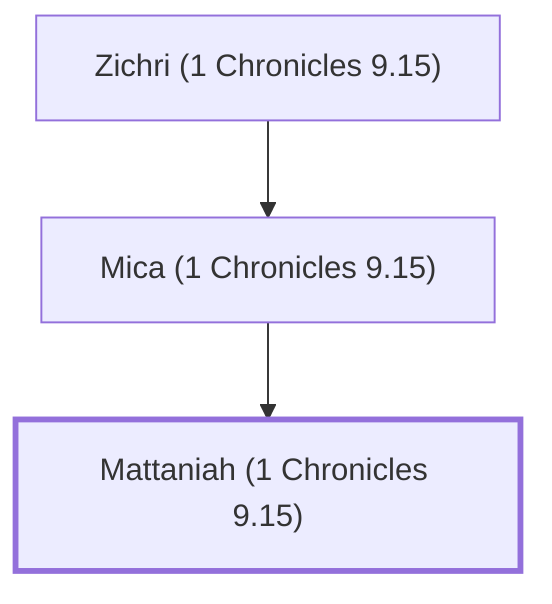

# Mattaniah (1 Chronicles 9.15)

Levite singer and gatekeeper during the time of Nehemiah.

**Original-language names:** מַתַּנְיָ֫הוּ (H4983)

## When

- **Placed around:** [[connections/timeline/5th century BC|445 BC]] *(Ussher: the median date of the passages naming them)*

## Family

- **Father:** [[connections/people/Mica (1 Chronicles 9.15)|Mica (1 Chronicles 9.15)]]
- **Tribe or nation:** Tribe of Levi

**Line of descent** (4 generations, father to son): [[connections/people/Asaph (1 Chronicles 9.15)|Asaph (1 Chronicles 9.15)]] → [[connections/people/Zichri (1 Chronicles 9.15)|Zichri (1 Chronicles 9.15)]] → [[connections/people/Mica (1 Chronicles 9.15)|Mica (1 Chronicles 9.15)]] → **Mattaniah (1 Chronicles 9.15)**

**Family group:** [[connections/genealogy/Family of Asaph (1 Chronicles 9.15)|Family of Asaph (1 Chronicles 9.15)]], generation 4

## Appears in

[[connections/chapters/13-1-chronicles/1 Chronicles 9|1 Chronicles 9]] · [[connections/chapters/16-nehemiah/Nehemiah 11|Nehemiah 11]] · [[connections/chapters/16-nehemiah/Nehemiah 12|Nehemiah 12 (2)]]

## Appears in the same verse as

[[connections/people/Asaph (1 Chronicles 9.15)|Asaph (1 Chronicles 9.15) (2)]] · [[connections/people/Bakbukiah|Bakbukiah (2)]] · [[connections/people/Mica (1 Chronicles 9.15)|Mica (1 Chronicles 9.15) (2)]] · [[connections/people/Obadiah (1 Chronicles 9.16)|Obadiah (1 Chronicles 9.16) (2)]] · [[connections/people/Zichri (1 Chronicles 9.15)|Zichri (1 Chronicles 9.15) (2)]] · [[connections/people/Akkub (1 Chronicles 9.17)|Akkub (1 Chronicles 9.17)]] · [[connections/people/Bakbakkar|Bakbakkar]] · [[connections/people/Bani (Nehemiah 8.7)|Bani (Nehemiah 8.7)]] · [[connections/people/Galal (1 Chronicles 9.15)|Galal (1 Chronicles 9.15)]] · [[connections/people/Galal (1 Chronicles 9.16)|Galal (1 Chronicles 9.16)]] · [[connections/people/Heresh|Heresh]] · [[connections/people/Hodiah (Nehemiah 8.7)|Hodiah (Nehemiah 8.7)]] · [[connections/people/Jeduthun (1 Chronicles 9.16)|Jeduthun (1 Chronicles 9.16)]] · [[connections/people/Jeshua (Ezra 2.40)|Jeshua (Ezra 2.40)]] · [[connections/people/Kadmiel|Kadmiel]] · [[connections/people/Meshullam (Nehemiah 12.25)|Meshullam (Nehemiah 12.25)]] · [[connections/people/Shemaiah (1 Chronicles 9.16)|Shemaiah (1 Chronicles 9.16)]] · [[connections/people/Sherebiah (Nehemiah 10.13)|Sherebiah (Nehemiah 10.13)]] · [[connections/people/Talmon|Talmon]]
