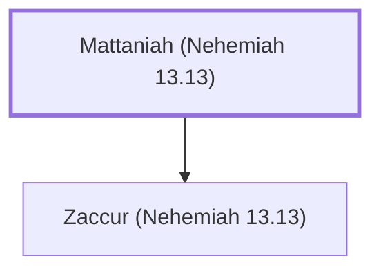

# Mattaniah (Nehemiah 13.13)

Levite appointed as a treasurer during Nehemiah's time.

**Original-language names:** מַתַּנְיָ֫הוּ (H4983)

## When

- **Placed around:** [[connections/timeline/5th century BC|445 BC]] *(Ussher: the median date of the passages naming them)*

## Family

- **Children:** [[connections/people/Zaccur (Nehemiah 13.13)|Zaccur (Nehemiah 13.13)]]

**Family group:** [[connections/genealogy/Family of Mattaniah (Nehemiah 13.13)|Family of Mattaniah (Nehemiah 13.13)]], generation 1

## Appears in

[[connections/chapters/16-nehemiah/Nehemiah 13|Nehemiah 13]]

## Appears in the same verse as

[[connections/people/Hanan (Nehemiah 13.13)|Hanan (Nehemiah 13.13)]] · [[connections/people/Pedaiah (Nehemiah 13.13)|Pedaiah (Nehemiah 13.13)]] · [[connections/people/Shelemiah (Nehemiah 13.13)|Shelemiah (Nehemiah 13.13)]] · [[connections/people/Zaccur (Nehemiah 13.13)|Zaccur (Nehemiah 13.13)]] · [[connections/people/Zadok (Nehemiah 13.13)|Zadok (Nehemiah 13.13)]]
