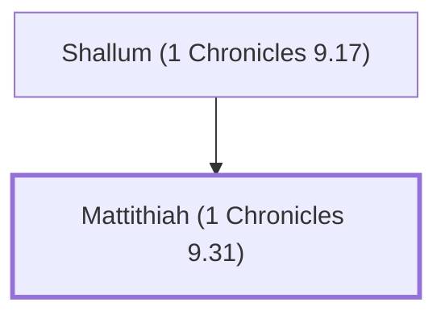

# Mattithiah (1 Chronicles 9.31)

Levite in charge of baking bread in the temple.

**Original-language names:** מַתִּתְיָ֫הוּ (H4993)

## When

- **Placed around:** [[connections/timeline/6th century BC|536 BC]] *(Ussher: the median date of the passages naming them)*

## Family

- **Father:** [[connections/people/Shallum (1 Chronicles 9.17)|Shallum (1 Chronicles 9.17)]]
- **Tribe or nation:** Tribe of Levi

**Family group:** [[connections/genealogy/Family of Shallum (1 Chronicles 9.17)|Family of Shallum (1 Chronicles 9.17)]], generation 2

## Appears in

[[connections/chapters/13-1-chronicles/1 Chronicles 9|1 Chronicles 9]]

## Appears in the same verse as

[[connections/people/Shallum (1 Chronicles 9.17)|Shallum (1 Chronicles 9.17)]]
