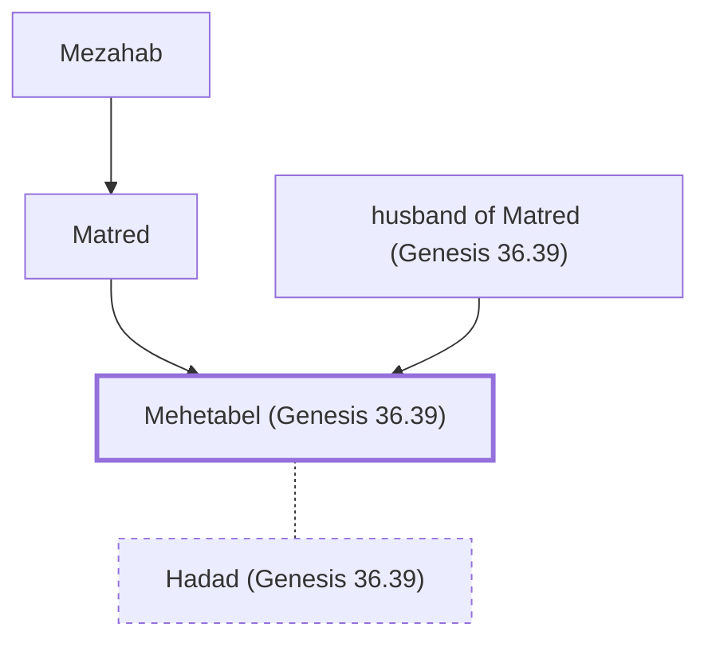

# Mehetabel (Genesis 36.39)

Wife of Hadar, king of Edom.

**Original-language names:** מְהֵיטַבְאֵל (H4105)

## When

- **Placed around:** [[connections/timeline/17th century BC|1617 BC]] *(Ussher: the median date of the passages naming them)*

## Family

- **Father:** [[connections/people/husband of Matred (Genesis 36.39)|husband of Matred (Genesis 36.39)]]
- **Mother:** [[connections/people/Matred|Matred]]
- **Spouses:** [[connections/people/Hadad (Genesis 36.39)|Hadad (Genesis 36.39)]]
- **Tribe or nation:** Edom

**Family group:** [[connections/genealogy/Family of Mezahab|Family of Mezahab]], generation 3

## Appears in

[[connections/chapters/01-genesis/Genesis 36|Genesis 36]] · [[connections/chapters/13-1-chronicles/1 Chronicles 1|1 Chronicles 1]]

## Appears in the same verse as

[[connections/people/Baal-hanan (Genesis 36.38)|Baal-hanan (Genesis 36.38) (2)]] · [[connections/people/Hadad (Genesis 36.39)|Hadad (Genesis 36.39) (2)]] · [[connections/people/Matred|Matred (2)]] · [[connections/people/Mezahab|Mezahab (2)]] · [[connections/places/Pau|Pau (2)]] · [[connections/people/Achbor (Genesis 36.38)|Achbor (Genesis 36.38)]]
