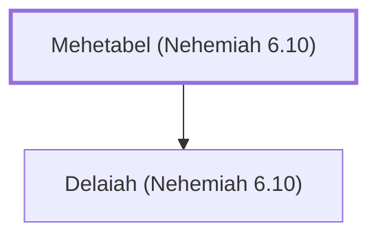

# Mehetabel (Nehemiah 6.10)

Ancestor of Shemaiah, who opposed Nehemiah.

**Original-language names:** מְהֵיטַבְאֵל (H4105)

## When

- **Placed around:** [[connections/timeline/5th century BC|445 BC]] *(Ussher: the median date of the passages naming them)*

## Family

- **Children:** [[connections/people/Delaiah (Nehemiah 6.10)|Delaiah (Nehemiah 6.10)]]

**Family group:** [[connections/genealogy/Family of Mehetabel (Nehemiah 6.10)|Family of Mehetabel (Nehemiah 6.10)]], generation 1

## Appears in

[[connections/chapters/16-nehemiah/Nehemiah 6|Nehemiah 6]]

## Appears in the same verse as

[[connections/people/Delaiah (Nehemiah 6.10)|Delaiah (Nehemiah 6.10)]] · [[connections/people/Shemaiah (Nehemiah 6.10)|Shemaiah (Nehemiah 6.10)]]
