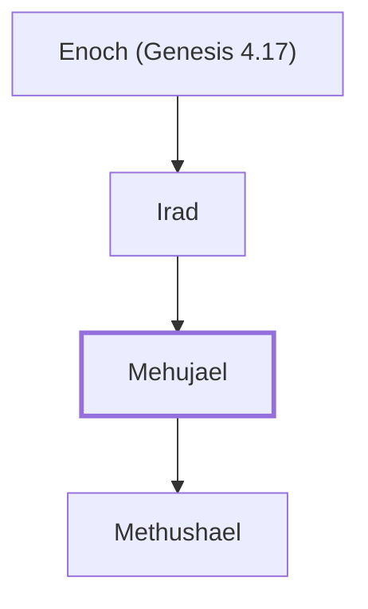

# Mehujael

Descendant of Cain; father of Methushael.

**Original-language names:** מְחוּיָאֵל (H4232)

## When

- **Placed around:** [[connections/timeline/41st century BC|4003 BC]] *(Ussher: the median date of the passages naming them)*

## Family

- **Father:** [[connections/people/Irad|Irad]]
- **Children:** [[connections/people/Methushael|Methushael]]
- **Tribe or nation:** Early Patriarch

**Line of descent** (5 generations, father to son): [[connections/people/Adam|Adam]] → [[connections/people/Cain|Cain]] → [[connections/people/Enoch (Genesis 4.17)|Enoch (Genesis 4.17)]] → [[connections/people/Irad|Irad]] → **Mehujael**

**Family group:** [[connections/genealogy/Family of Adam|Family of Adam]], generation 5

## Appears in

[[connections/chapters/01-genesis/Genesis 4|Genesis 4]]

## Appears in the same verse as

[[connections/people/Enoch (Genesis 4.17)|Enoch (Genesis 4.17)]] · [[connections/people/Irad|Irad]] · [[connections/people/Lamech (Genesis 4.18)|Lamech (Genesis 4.18)]] · [[connections/people/Methushael|Methushael]]
