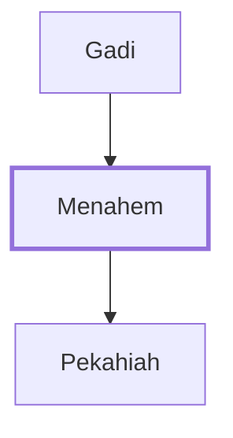

# Menahem

King of Israel who reigned for ten years.

**Original-language names:** מְנַחֵם (H4505)

## When

- **Placed around:** [[connections/timeline/8th century BC|772 BC]] *(Ussher: the median date of the passages naming them)*

## Family

- **Father:** [[connections/people/Gadi|Gadi]]
- **Children:** [[connections/people/Pekahiah|Pekahiah]]
- **Tribe or nation:** Israel

**Family group:** [[connections/genealogy/Family of Gadi|Family of Gadi]], generation 2

## Events

- [[connections/timeline/8th century BC|772 BC]] · [[connections/events/Death of Shallum|Death of Shallum]]
- [[connections/timeline/8th century BC|772 BC]] · [[connections/events/Reign of Menahem|Reign of Menahem]]
- [[connections/timeline/8th century BC|761 BC]] · [[connections/events/Death of Menahem|Death of Menahem]]

## Appears in

[[connections/chapters/12-2-kings/2 Kings 15|2 Kings 15 (8)]]

## Appears in the same verse as

[[connections/people/Israel|Israel (4)]] · [[connections/places/Samaria|Samaria (3)]] · [[connections/people/Gadi|Gadi (2)]] · [[connections/people/Judah (Genesis 29.35)|Judah (Genesis 29.35) (2)]] · [[connections/people/Pekahiah|Pekahiah (2)]] · [[connections/people/Uzziah (2 Kings 14.21)|Uzziah (2 Kings 14.21) (2)]] · [[connections/places/Assyria|Assyria (2)]] · [[connections/places/Tirzah|Tirzah (2)]] · [[connections/people/Jabesh|Jabesh]] · [[connections/people/Shallum (2 Kings 15.10)|Shallum (2 Kings 15.10)]] · [[connections/people/Tiglath-pileser|Tiglath-pileser]] · [[connections/places/Tiphsah (2 Kings 15.16)|Tiphsah (2 Kings 15.16)]]
