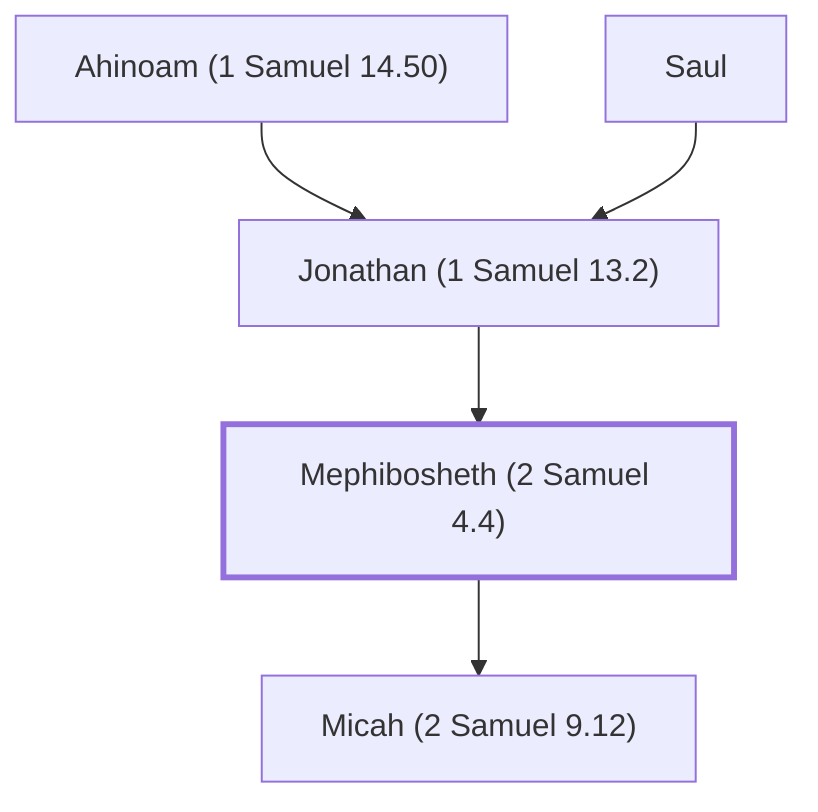

# Mephibosheth (2 Samuel 4.4)

Son of Jonathan and grandson of King Saul.

**Also called:** Merib-baal, Meri-baal

**Original-language names:** מְפִיבֹשֶׁת (H4648) · מְרִיב בַּ֫עַל (H4807) · מְרִי בַעַל (H4810)

## When

- **Placed around:** [[connections/timeline/11th century BC|1040 BC]] *(Ussher: the median date of the passages naming them)*

## Family

- **Father:** [[connections/people/Jonathan (1 Samuel 13.2)|Jonathan (1 Samuel 13.2)]]
- **Children:** [[connections/people/Micah (2 Samuel 9.12)|Micah (2 Samuel 9.12)]]
- **Tribe or nation:** Tribe of Benjamin

**Line of descent** (8 generations, father to son): [[connections/people/Aphiah|Aphiah]] → [[connections/people/Becorath|Becorath]] → [[connections/people/Zeror|Zeror]] → [[connections/people/Abiel|Abiel]] → [[connections/people/Kish (1 Samuel 9.1)|Kish (1 Samuel 9.1)]] → [[connections/people/Saul|Saul]] → [[connections/people/Jonathan (1 Samuel 13.2)|Jonathan (1 Samuel 13.2)]] → **Mephibosheth (2 Samuel 4.4)**

**Family group:** [[connections/genealogy/Family of Aphiah|Family of Aphiah]], generation 8

## Appears in

[[connections/chapters/10-2-samuel/2 Samuel 4|2 Samuel 4]] · [[connections/chapters/10-2-samuel/2 Samuel 9|2 Samuel 9 (5)]] · [[connections/chapters/10-2-samuel/2 Samuel 16|2 Samuel 16 (2)]] · [[connections/chapters/10-2-samuel/2 Samuel 19|2 Samuel 19 (3)]] · [[connections/chapters/10-2-samuel/2 Samuel 21|2 Samuel 21]] · [[connections/chapters/13-1-chronicles/1 Chronicles 8|1 Chronicles 8]] · [[connections/chapters/13-1-chronicles/1 Chronicles 9|1 Chronicles 9]]

## Appears in the same verse as

[[connections/people/Jonathan (1 Samuel 13.2)|Jonathan (1 Samuel 13.2) (5)]] · [[connections/people/Ziba|Ziba (5)]] · [[connections/people/Saul|Saul (4)]] · [[connections/people/David|David (3)]] · [[connections/people/Micah (2 Samuel 9.12)|Micah (2 Samuel 9.12) (3)]] · [[connections/places/Jerusalem|Jerusalem (2)]] · [[connections/places/Jezreel (2 Samuel 4.4)|Jezreel (2 Samuel 4.4)]]
