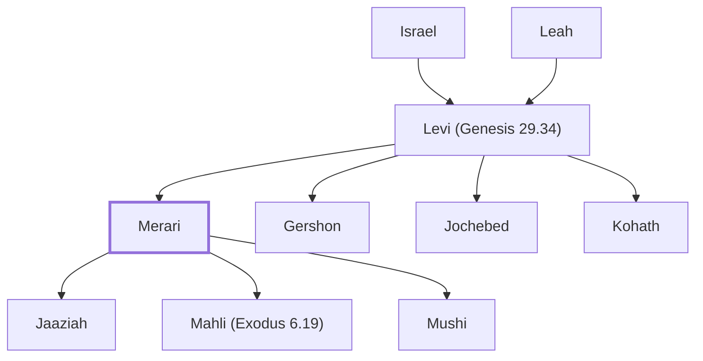

# Merari

The third son of Levi and founder of the Merarites.

**Original-language names:** מְרָרִי (H4847)

## When

- **Placed around:** [[connections/timeline/15th century BC|1443 BC]] *(Ussher: the median date of the passages naming them)*

## Family

- **Father:** [[connections/people/Levi (Genesis 29.34)|Levi (Genesis 29.34)]]
- **Brothers and sisters:** [[connections/people/Gershon|Gershon]], [[connections/people/Jochebed|Jochebed]], [[connections/people/Kohath|Kohath]]
- **Children:** [[connections/people/Jaaziah|Jaaziah]], [[connections/people/Mahli (Exodus 6.19)|Mahli (Exodus 6.19)]], [[connections/people/Mushi|Mushi]]
- **Tribe or nation:** Tribe of Levi

**Line of descent** (25 generations, father to son): [[connections/people/Adam|Adam]] → [[connections/people/Seth|Seth]] → [[connections/people/Enosh|Enosh]] → [[connections/people/Kenan|Kenan]] → [[connections/people/Mahalalel (Genesis 5.12)|Mahalalel (Genesis 5.12)]] → [[connections/people/Jared|Jared]] → [[connections/people/Enoch (Genesis 5.18)|Enoch (Genesis 5.18)]] → [[connections/people/Methuselah|Methuselah]] → [[connections/people/Lamech (Genesis 5.25)|Lamech (Genesis 5.25)]] → [[connections/people/Noah (Genesis 5.29)|Noah (Genesis 5.29)]] → [[connections/people/Shem|Shem]] → [[connections/people/Arpachshad|Arpachshad]] → [[connections/people/Cainan|Cainan]] → [[connections/people/Shelah (Genesis 10.24)|Shelah (Genesis 10.24)]] → [[connections/people/Eber (Genesis 10.21)|Eber (Genesis 10.21)]] → [[connections/people/Peleg|Peleg]] → [[connections/people/Reu|Reu]] → [[connections/people/Serug|Serug]] → [[connections/people/Nahor (Genesis 11.22)|Nahor (Genesis 11.22)]] → [[connections/people/Terah|Terah]] → [[connections/people/Abraham|Abraham]] → [[connections/people/Isaac|Isaac]] → [[connections/people/Israel|Israel]] → [[connections/people/Levi (Genesis 29.34)|Levi (Genesis 29.34)]] → **Merari**

**Family group:** [[connections/genealogy/Family of Adam|Family of Adam]], generation 25

## Appears in

[[connections/chapters/01-genesis/Genesis 46|Genesis 46]] · [[connections/chapters/02-exodus/Exodus 6|Exodus 6 (2)]] · [[connections/chapters/04-numbers/Numbers 3|Numbers 3 (4)]] · [[connections/chapters/04-numbers/Numbers 4|Numbers 4 (4)]] · [[connections/chapters/04-numbers/Numbers 7|Numbers 7]] · [[connections/chapters/04-numbers/Numbers 10|Numbers 10]] · [[connections/chapters/04-numbers/Numbers 26|Numbers 26]] · [[connections/chapters/06-joshua/Joshua 21|Joshua 21 (3)]] · [[connections/chapters/13-1-chronicles/1 Chronicles 5|1 Chronicles 5]] · [[connections/chapters/13-1-chronicles/1 Chronicles 6|1 Chronicles 6 (7)]] · [[connections/chapters/13-1-chronicles/1 Chronicles 9|1 Chronicles 9]] · [[connections/chapters/13-1-chronicles/1 Chronicles 15|1 Chronicles 15 (2)]] · [[connections/chapters/13-1-chronicles/1 Chronicles 23|1 Chronicles 23 (2)]] · [[connections/chapters/13-1-chronicles/1 Chronicles 24|1 Chronicles 24 (2)]] · [[connections/chapters/13-1-chronicles/1 Chronicles 26|1 Chronicles 26 (2)]] · [[connections/chapters/14-2-chronicles/2 Chronicles 29|2 Chronicles 29]] · [[connections/chapters/14-2-chronicles/2 Chronicles 34|2 Chronicles 34]] · [[connections/chapters/15-ezra/Ezra 8|Ezra 8]]

## Appears in the same verse as

[[connections/people/Gershon|Gershon (8)]] · [[connections/people/Levi (Genesis 29.34)|Levi (Genesis 29.34) (8)]] · [[connections/people/Kohath|Kohath (7)]] · [[connections/people/Mahli (Exodus 6.19)|Mahli (Exodus 6.19) (6)]] · [[connections/people/Mushi|Mushi (6)]] · [[connections/people/Zebulun|Zebulun (4)]] · [[connections/people/Aaron|Aaron (3)]] · [[connections/people/Beno|Beno (2)]] · [[connections/people/Gad (Genesis 30.11)|Gad (Genesis 30.11) (2)]] · [[connections/people/Ithamar|Ithamar (2)]] · [[connections/people/Jaaziah|Jaaziah (2)]] · [[connections/people/Jeduthun (1 Chronicles 6.29)|Jeduthun (1 Chronicles 6.29) (2)]] · [[connections/people/Kishi|Kishi (2)]] · [[connections/people/Reuben|Reuben (2)]] · [[connections/people/Abdi (1 Chronicles 6.29)|Abdi (1 Chronicles 6.29)]] · [[connections/people/Abdi (2 Chronicles 29.12)|Abdi (2 Chronicles 29.12)]] · [[connections/people/Amasai (2 Chronicles 29.12)|Amasai (2 Chronicles 29.12)]] · [[connections/people/Asaiah (1 Chronicles 15.6)|Asaiah (1 Chronicles 15.6)]] · [[connections/people/Asaph (1 Chronicles 6.24)|Asaph (1 Chronicles 6.24)]] · [[connections/people/Azariah (2 Chronicles 29.12)|Azariah (2 Chronicles 29.12)]] · [[connections/people/Azariah (2 Chronicles 29.12)|Azariah (2 Chronicles 29.12)]] · [[connections/people/Azrikam (1 Chronicles 9.14)|Azrikam (1 Chronicles 9.14)]] · [[connections/people/Berechiah (1 Chronicles 6.24)|Berechiah (1 Chronicles 6.24)]] · [[connections/people/David|David]] · [[connections/people/Eden (2 Chronicles 29.12)|Eden (2 Chronicles 29.12)]] · [[connections/people/Eleazar (1 Chronicles 23.21)|Eleazar (1 Chronicles 23.21)]] · [[connections/people/Hashabiah (1 Chronicles 9.14)|Hashabiah (1 Chronicles 9.14)]] · [[connections/people/Hashabiah (Ezra 8.19)|Hashabiah (Ezra 8.19)]] · [[connections/people/Hasshub (1 Chronicles 9.14)|Hasshub (1 Chronicles 9.14)]] · [[connections/people/Heman (1 Chronicles 6.18)|Heman (1 Chronicles 6.18)]] · [[connections/people/Hosah|Hosah]] · [[connections/people/Ibri|Ibri]] · [[connections/people/Jahath (2 Chronicles 34.12)|Jahath (2 Chronicles 34.12)]] · [[connections/people/Jehallelel (2 Chronicles 29.12)|Jehallelel (2 Chronicles 29.12)]] · [[connections/people/Jeshaiah (Ezra 8.19)|Jeshaiah (Ezra 8.19)]] · [[connections/people/Joah (2 Chronicles 29.12)|Joah (2 Chronicles 29.12)]] · [[connections/people/Joah (2 Chronicles 29.12)|Joah (2 Chronicles 29.12)]] · [[connections/people/Joel (1 Samuel 8.2)|Joel (1 Samuel 8.2)]] · [[connections/people/Joel (2 Chronicles 29.12)|Joel (2 Chronicles 29.12)]] · [[connections/people/Kish (1 Chronicles 23.21)|Kish (1 Chronicles 23.21)]] · [[connections/people/Kish (2 Chronicles 29.12)|Kish (2 Chronicles 29.12)]] · [[connections/people/Libni (1 Chronicles 6.14)|Libni (1 Chronicles 6.14)]] · [[connections/people/Mahath (2 Chronicles 29.12)|Mahath (2 Chronicles 29.12)]] · [[connections/people/Mahli (1 Chronicles 6.32)|Mahli (1 Chronicles 6.32)]] · [[connections/people/Malluch (1 Chronicles 6.29)|Malluch (1 Chronicles 6.29)]] · [[connections/people/Meshullam (2 Chronicles 34.12)|Meshullam (2 Chronicles 34.12)]] · [[connections/people/Moses|Moses]] · [[connections/people/Obadiah (2 Chronicles 34.12)|Obadiah (2 Chronicles 34.12)]] · [[connections/people/Shemaiah (1 Chronicles 9.14)|Shemaiah (1 Chronicles 9.14)]] · [[connections/people/Shimei (1 Chronicles 6.14)|Shimei (1 Chronicles 6.14)]] · [[connections/people/Shimri (1 Chronicles 26.10)|Shimri (1 Chronicles 26.10)]] · [[connections/people/Shoham|Shoham]] · [[connections/people/Uzzah (1 Chronicles 6.14)|Uzzah (1 Chronicles 6.14)]] · [[connections/people/Zaccur (1 Chronicles 24.27)|Zaccur (1 Chronicles 24.27)]] · [[connections/people/Zechariah (2 Chronicles 34.12)|Zechariah (2 Chronicles 34.12)]] · [[connections/people/Zimmah (2 Chronicles 29.12)|Zimmah (2 Chronicles 29.12)]] · [[connections/places/Chesulloth|Chesulloth]] · [[connections/places/Dimnah|Dimnah]] · [[connections/places/Jokneam|Jokneam]] · [[connections/places/Kitron|Kitron]]
