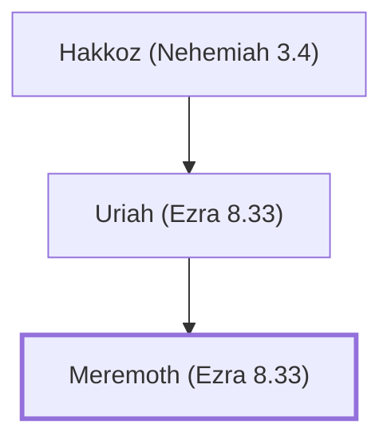

# Meremoth (Ezra 8.33)

A priest who returned from the Babylonian exile.

**Also called:** Meraioth

**Original-language names:** מְרֵמוֹת (H4822) · מְרָיוֹת (H4812)

## When

- **Placed around:** [[connections/timeline/5th century BC|445 BC]] *(Ussher: the median date of the passages naming them)*

## Family

- **Father:** [[connections/people/Uriah (Ezra 8.33)|Uriah (Ezra 8.33)]]

**Line of descent** (3 generations, father to son): [[connections/people/Hakkoz (Nehemiah 3.4)|Hakkoz (Nehemiah 3.4)]] → [[connections/people/Uriah (Ezra 8.33)|Uriah (Ezra 8.33)]] → **Meremoth (Ezra 8.33)**

**Family group:** [[connections/genealogy/Family of Hakkoz (Nehemiah 3.4)|Family of Hakkoz (Nehemiah 3.4)]], generation 3

## Appears in

[[connections/chapters/15-ezra/Ezra 8|Ezra 8]] · [[connections/chapters/16-nehemiah/Nehemiah 3|Nehemiah 3 (2)]] · [[connections/chapters/16-nehemiah/Nehemiah 10|Nehemiah 10]] · [[connections/chapters/16-nehemiah/Nehemiah 12|Nehemiah 12 (2)]]

## Appears in the same verse as

[[connections/people/Rehum (Ezra 2.2)|Rehum (Ezra 2.2) (3)]] · [[connections/people/Uriah (Ezra 8.33)|Uriah (Ezra 8.33) (3)]] · [[connections/people/Hakkoz (Nehemiah 3.4)|Hakkoz (Nehemiah 3.4) (2)]] · [[connections/people/Adna (Nehemiah 12.15)|Adna (Nehemiah 12.15)]] · [[connections/people/Baana (Nehemiah 3.4)|Baana (Nehemiah 3.4)]] · [[connections/people/Berechiah (Nehemiah 3.4)|Berechiah (Nehemiah 3.4)]] · [[connections/people/Binnui (Ezra 8.33)|Binnui (Ezra 8.33)]] · [[connections/people/Eleazar (Ezra 8.33)|Eleazar (Ezra 8.33)]] · [[connections/people/Eliashib (Nehemiah 3.1)|Eliashib (Nehemiah 3.1)]] · [[connections/people/Helkai|Helkai]] · [[connections/people/Jeshua (Ezra 8.33)|Jeshua (Ezra 8.33)]] · [[connections/people/Jozabad (Ezra 8.33)|Jozabad (Ezra 8.33)]] · [[connections/people/Meshezabel (Nehemiah 3.4)|Meshezabel (Nehemiah 3.4)]] · [[connections/people/Meshullam (Nehemiah 3.4)|Meshullam (Nehemiah 3.4)]] · [[connections/people/Noadiah (Ezra 8.33)|Noadiah (Ezra 8.33)]] · [[connections/people/Obadiah (Nehemiah 10.6)|Obadiah (Nehemiah 10.6)]] · [[connections/people/Phinehas (Ezra 8.33)|Phinehas (Ezra 8.33)]] · [[connections/people/Shebaniah (Nehemiah 10.5)|Shebaniah (Nehemiah 10.5)]] · [[connections/people/Zadok (Nehemiah 3.4)|Zadok (Nehemiah 3.4)]]
