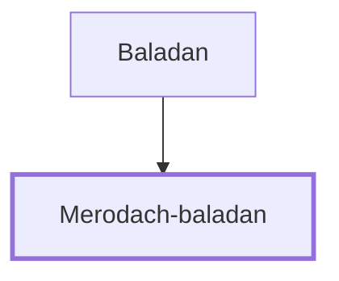

# Merodach-baladan

King of Babylon who sent envoys to Hezekiah.

**Original-language names:** מְרֹדַךְ בַּלְאֲדָן (H4757) · בְּרֹאדַךְ בַּלְאֲדָן (H1255)

## When

- **Placed around:** [[connections/timeline/8th century BC|712 BC]] *(Ussher: the median date of the passages naming them)*
- **Reigned / in office:** [[connections/timeline/8th century BC|722 BC]] – [[connections/timeline/8th century BC|703 BC]] *(modern dates)* · Marduk-apla-iddina II, Babylon · [Wikidata Q356505](https://www.wikidata.org/wiki/Q356505) · Reigned 722-710 and again in 703 BC

## Family

- **Father:** [[connections/people/Baladan|Baladan]]
- **Tribe or nation:** Mesopotamia

**Family group:** [[connections/genealogy/Family of Baladan|Family of Baladan]], generation 2

## Appears in

[[connections/chapters/12-2-kings/2 Kings 20|2 Kings 20]] · [[connections/chapters/23-isaiah/Isaiah 39|Isaiah 39]]

## Appears in the same verse as

[[connections/people/Baladan|Baladan (2)]] · [[connections/people/Hezekiah (2 Kings 16.20)|Hezekiah (2 Kings 16.20) (2)]] · [[connections/places/Babylon|Babylon (2)]]
