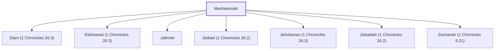

# Meshelemiah

A Levite gatekeeper in the time of David.

**Also called:** Shelemiah

**Original-language names:** מְשֶׁלֶמְיָהוּ (H4920) · שֶׁלֶמְיָהוּ (H8018)

## When

- **Placed around:** [[connections/timeline/11th century BC|1015 BC]] *(Ussher: the median date of the passages naming them)*

## Family

- **Children:** [[connections/people/Elam (1 Chronicles 26.3)|Elam (1 Chronicles 26.3)]], [[connections/people/Eliehoenai (1 Chronicles 26.3)|Eliehoenai (1 Chronicles 26.3)]], [[connections/people/Jathniel|Jathniel]], [[connections/people/Jediael (1 Chronicles 26.2)|Jediael (1 Chronicles 26.2)]], [[connections/people/Jehohanan (1 Chronicles 26.3)|Jehohanan (1 Chronicles 26.3)]], [[connections/people/Zebadiah (1 Chronicles 26.2)|Zebadiah (1 Chronicles 26.2)]], [[connections/people/Zechariah (1 Chronicles 9.21)|Zechariah (1 Chronicles 9.21)]]
- **Tribe or nation:** Tribe of Levi

**Family group:** [[connections/genealogy/Family of Meshelemiah|Family of Meshelemiah]], generation 1

## Appears in

[[connections/chapters/13-1-chronicles/1 Chronicles 9|1 Chronicles 9]] · [[connections/chapters/13-1-chronicles/1 Chronicles 26|1 Chronicles 26 (4)]]

## Appears in the same verse as

[[connections/people/Zechariah (1 Chronicles 9.21)|Zechariah (1 Chronicles 9.21) (3)]] · [[connections/people/Ebiasaph|Ebiasaph]] · [[connections/people/Jathniel|Jathniel]] · [[connections/people/Jediael (1 Chronicles 26.2)|Jediael (1 Chronicles 26.2)]] · [[connections/people/Kore (1 Chronicles 9.19)|Kore (1 Chronicles 9.19)]] · [[connections/people/Zebadiah (1 Chronicles 26.2)|Zebadiah (1 Chronicles 26.2)]]
