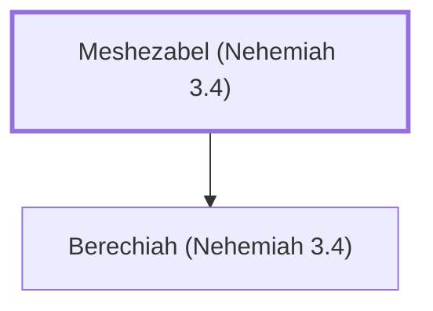

# Meshezabel (Nehemiah 3.4)

One who helped repair the wall of Jerusalem.

**Original-language names:** מְשֵׁיזַבְאֵל (H4898)

## When

- **Placed around:** [[connections/timeline/5th century BC|445 BC]] *(Ussher: the median date of the passages naming them)*

## Family

- **Children:** [[connections/people/Berechiah (Nehemiah 3.4)|Berechiah (Nehemiah 3.4)]]

**Family group:** [[connections/genealogy/Family of Meshezabel (Nehemiah 3.4)|Family of Meshezabel (Nehemiah 3.4)]], generation 1

## Appears in

[[connections/chapters/16-nehemiah/Nehemiah 3|Nehemiah 3]]

## Appears in the same verse as

[[connections/people/Baana (Nehemiah 3.4)|Baana (Nehemiah 3.4)]] · [[connections/people/Berechiah (Nehemiah 3.4)|Berechiah (Nehemiah 3.4)]] · [[connections/people/Hakkoz (Nehemiah 3.4)|Hakkoz (Nehemiah 3.4)]] · [[connections/people/Meremoth (Ezra 8.33)|Meremoth (Ezra 8.33)]] · [[connections/people/Meshullam (Nehemiah 3.4)|Meshullam (Nehemiah 3.4)]] · [[connections/people/Uriah (Ezra 8.33)|Uriah (Ezra 8.33)]] · [[connections/people/Zadok (Nehemiah 3.4)|Zadok (Nehemiah 3.4)]]
