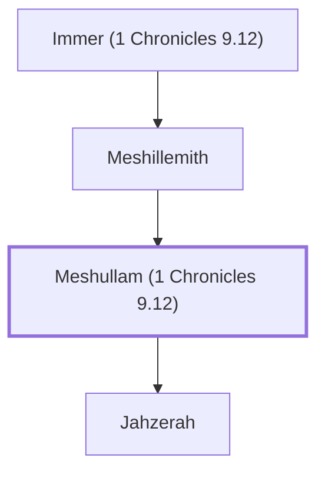

# Meshullam (1 Chronicles 9.12)

A priest who lived in Jerusalem after the exile.

**Also called:** Ahzai

**Original-language names:** מְשֻׁלָּם (H4918) · אַחְזַי (H0273)

## When

- **Placed around:** [[connections/timeline/5th century BC|445 BC]] *(Ussher: the median date of the passages naming them)*

## Family

- **Father:** [[connections/people/Meshillemith|Meshillemith]]
- **Children:** [[connections/people/Jahzerah|Jahzerah]]
- **Tribe or nation:** Tribe of Levi

**Line of descent** (3 generations, father to son): [[connections/people/Immer (1 Chronicles 9.12)|Immer (1 Chronicles 9.12)]] → [[connections/people/Meshillemith|Meshillemith]] → **Meshullam (1 Chronicles 9.12)**

**Family group:** [[connections/genealogy/Family of Immer (1 Chronicles 9.12)|Family of Immer (1 Chronicles 9.12)]], generation 3

## Appears in

[[connections/chapters/13-1-chronicles/1 Chronicles 9|1 Chronicles 9]] · [[connections/chapters/16-nehemiah/Nehemiah 11|Nehemiah 11]]

## Appears in the same verse as

[[connections/people/Adiel (1 Chronicles 9.12)|Adiel (1 Chronicles 9.12) (2)]] · [[connections/people/Immer (1 Chronicles 9.12)|Immer (1 Chronicles 9.12) (2)]] · [[connections/people/Maasai|Maasai (2)]] · [[connections/people/Meshillemith|Meshillemith (2)]] · [[connections/people/Adaiah (1 Chronicles 9.12)|Adaiah (1 Chronicles 9.12)]] · [[connections/people/Jahzerah|Jahzerah]] · [[connections/people/Jeroham (1 Chronicles 9.12)|Jeroham (1 Chronicles 9.12)]] · [[connections/people/Malchijah (1 Chronicles 9.12)|Malchijah (1 Chronicles 9.12)]] · [[connections/people/Pashhur (1 Chronicles 9.12)|Pashhur (1 Chronicles 9.12)]]
