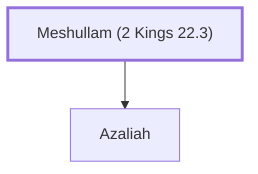

# Meshullam (2 Kings 22.3)

Grandfather of Shaphan the scribe during Josiah's reign.

**Original-language names:** מְשֻׁלָּם (H4918)

## When

- **Placed around:** [[connections/timeline/7th century BC|642 BC]] *(Ussher: the median date of the passages naming them)*

## Family

- **Children:** [[connections/people/Azaliah|Azaliah]]

**Family group:** [[connections/genealogy/Family of Meshullam (2 Kings 22.3)|Family of Meshullam (2 Kings 22.3)]], generation 1

## Appears in

[[connections/chapters/12-2-kings/2 Kings 22|2 Kings 22]]

## Appears in the same verse as

[[connections/people/Azaliah|Azaliah]] · [[connections/people/Josiah (1 Kings 13.2)|Josiah (1 Kings 13.2)]] · [[connections/people/Shaphan (2 Kings 22.3)|Shaphan (2 Kings 22.3)]]
