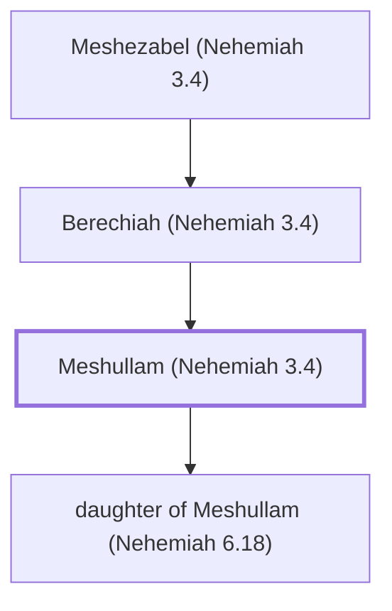

# Meshullam (Nehemiah 3.4)

Helped repair the wall of Jerusalem under Nehemiah.

**Original-language names:** מְשֻׁלָּם (H4918)

## When

- **Placed around:** [[connections/timeline/5th century BC|445 BC]] *(Ussher: the median date of the passages naming them)*

## Family

- **Father:** [[connections/people/Berechiah (Nehemiah 3.4)|Berechiah (Nehemiah 3.4)]]
- **Children:** [[connections/people/daughter of Meshullam (Nehemiah 6.18)|daughter of Meshullam (Nehemiah 6.18)]]

**Line of descent** (3 generations, father to son): [[connections/people/Meshezabel (Nehemiah 3.4)|Meshezabel (Nehemiah 3.4)]] → [[connections/people/Berechiah (Nehemiah 3.4)|Berechiah (Nehemiah 3.4)]] → **Meshullam (Nehemiah 3.4)**

**Family group:** [[connections/genealogy/Family of Meshezabel (Nehemiah 3.4)|Family of Meshezabel (Nehemiah 3.4)]], generation 3

## Appears in

[[connections/chapters/16-nehemiah/Nehemiah 3|Nehemiah 3 (2)]] · [[connections/chapters/16-nehemiah/Nehemiah 6|Nehemiah 6]]

## Appears in the same verse as

[[connections/people/Berechiah (Nehemiah 3.4)|Berechiah (Nehemiah 3.4) (3)]] · [[connections/people/Arah (Nehemiah 6.18)|Arah (Nehemiah 6.18)]] · [[connections/people/Baana (Nehemiah 3.4)|Baana (Nehemiah 3.4)]] · [[connections/people/Hakkoz (Nehemiah 3.4)|Hakkoz (Nehemiah 3.4)]] · [[connections/people/Hananiah (Nehemiah 3.30)|Hananiah (Nehemiah 3.30)]] · [[connections/people/Hanun (Nehemiah 3.30)|Hanun (Nehemiah 3.30)]] · [[connections/people/Jehohanan (Nehemiah 6.18)|Jehohanan (Nehemiah 6.18)]] · [[connections/people/Judah (Genesis 29.35)|Judah (Genesis 29.35)]] · [[connections/people/Meremoth (Ezra 8.33)|Meremoth (Ezra 8.33)]] · [[connections/people/Meshezabel (Nehemiah 3.4)|Meshezabel (Nehemiah 3.4)]] · [[connections/people/Shecaniah (Nehemiah 6.18)|Shecaniah (Nehemiah 6.18)]] · [[connections/people/Shelemiah (Nehemiah 3.30)|Shelemiah (Nehemiah 3.30)]] · [[connections/people/Uriah (Ezra 8.33)|Uriah (Ezra 8.33)]] · [[connections/people/Zadok (Nehemiah 3.4)|Zadok (Nehemiah 3.4)]] · [[connections/people/Zalaph|Zalaph]]
