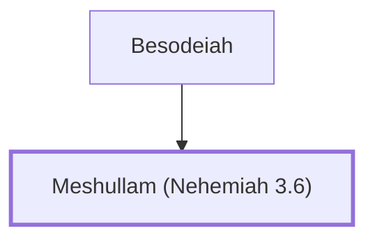

# Meshullam (Nehemiah 3.6)

Helped repair the Old Gate in Jerusalem's wall.

**Original-language names:** מְשֻׁלָּם (H4918)

## When

- **Placed around:** [[connections/timeline/5th century BC|445 BC]] *(Ussher: the median date of the passages naming them)*

## Family

- **Father:** [[connections/people/Besodeiah|Besodeiah]]

**Family group:** [[connections/genealogy/Family of Besodeiah|Family of Besodeiah]], generation 2

## Appears in

[[connections/chapters/16-nehemiah/Nehemiah 3|Nehemiah 3]]

## Appears in the same verse as

[[connections/people/Besodeiah|Besodeiah]] · [[connections/people/Joiada (Nehemiah 3.6)|Joiada (Nehemiah 3.6)]] · [[connections/people/Paseah (Nehemiah 3.6)|Paseah (Nehemiah 3.6)]] · [[connections/places/Yeshanah Gate|Yeshanah Gate]]
