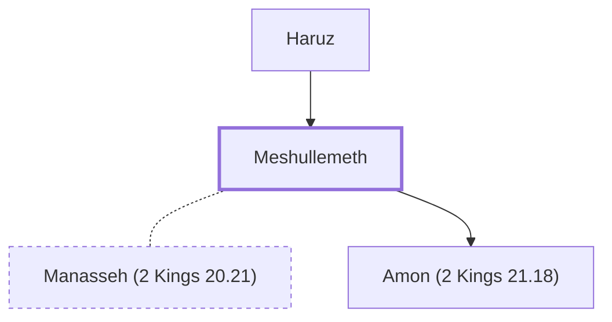

# Meshullemeth

Mother of Amon, king of Judah.

**Original-language names:** מְשֻׁלֶּ֫מֶת (H4922)

## When

- **Placed around:** [[connections/timeline/7th century BC|643 BC]] *(Ussher: the median date of the passages naming them)*

## Family

- **Father:** [[connections/people/Haruz|Haruz]]
- **Spouses:** [[connections/people/Manasseh (2 Kings 20.21)|Manasseh (2 Kings 20.21)]]
- **Children:** [[connections/people/Amon (2 Kings 21.18)|Amon (2 Kings 21.18)]]

**Family group:** [[connections/genealogy/Family of Adam|Family of Adam]], generation 2

## Appears in

[[connections/chapters/12-2-kings/2 Kings 21|2 Kings 21]]

## Appears in the same verse as

[[connections/people/Amon (2 Kings 21.18)|Amon (2 Kings 21.18)]] · [[connections/people/Haruz|Haruz]] · [[connections/places/Jerusalem|Jerusalem]] · [[connections/places/Jotbah|Jotbah]]
