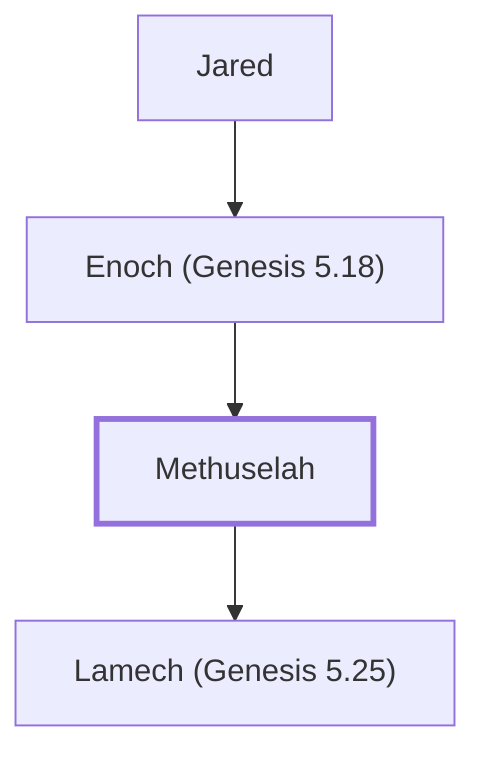

# Methuselah

The oldest person mentioned in the Bible.

**Original-language names:** מְתוּשֶׁ֫לַח (H4968) · Μαθουσάλα (G3103)

## When

- **Lived:** [[connections/timeline/34th century BC|3317 BC]] – [[connections/timeline/24th century BC|2348 BC]] *(Jones)*
- **Placed around:** [[connections/timeline/32nd century BC|3130 BC]] *(Ussher: the median date of the passages naming them)*

## Family

- **Father:** [[connections/people/Enoch (Genesis 5.18)|Enoch (Genesis 5.18)]]
- **Children:** [[connections/people/Lamech (Genesis 5.25)|Lamech (Genesis 5.25)]]
- **Tribe or nation:** Early Patriarch

**Line of descent** (8 generations, father to son): [[connections/people/Adam|Adam]] → [[connections/people/Seth|Seth]] → [[connections/people/Enosh|Enosh]] → [[connections/people/Kenan|Kenan]] → [[connections/people/Mahalalel (Genesis 5.12)|Mahalalel (Genesis 5.12)]] → [[connections/people/Jared|Jared]] → [[connections/people/Enoch (Genesis 5.18)|Enoch (Genesis 5.18)]] → **Methuselah**

**Family group:** [[connections/genealogy/Family of Adam|Family of Adam]], generation 8

## Events

- [[connections/timeline/34th century BC|3317 BC]] · [[connections/events/Birth of Methuselah|Birth of Methuselah]]
- [[connections/timeline/34th century BC|3317 BC]] · [[connections/events/Lifetime of Methuselah|Lifetime of Methuselah]]
- [[connections/timeline/32nd century BC|3130 BC]] · [[connections/events/Birth of Lamech|Birth of Lamech]]
- [[connections/timeline/24th century BC|2348 BC]] · [[connections/events/Death of Methuselah|Death of Methuselah]]

## Appears in

[[connections/chapters/01-genesis/Genesis 5|Genesis 5 (5)]] · [[connections/chapters/13-1-chronicles/1 Chronicles 1|1 Chronicles 1]] · [[connections/chapters/42-luke/Luke 3|Luke 3]]

## Appears in the same verse as

[[connections/people/Enoch (Genesis 5.18)|Enoch (Genesis 5.18) (4)]] · [[connections/people/Lamech (Genesis 5.25)|Lamech (Genesis 5.25) (3)]] · [[connections/people/Jared|Jared]] · [[connections/people/Kenan|Kenan]] · [[connections/people/Mahalalel (Genesis 5.12)|Mahalalel (Genesis 5.12)]]
