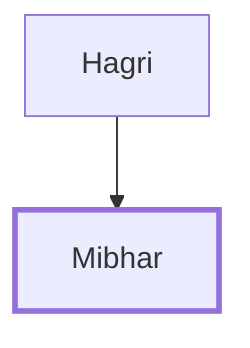

# Mibhar

One of David's mighty warriors, son of Hagri.

**Original-language names:** מִבְחָר (H4006)

## When

- **Placed around:** [[connections/timeline/11th century BC|1055 BC]] *(Ussher: the median date of the passages naming them)*

## Family

- **Father:** [[connections/people/Hagri|Hagri]]

**Family group:** [[connections/genealogy/Family of Hagri|Family of Hagri]], generation 2

## Appears in

[[connections/chapters/13-1-chronicles/1 Chronicles 11|1 Chronicles 11]]

## Appears in the same verse as

[[connections/people/Hagri|Hagri]] · [[connections/people/Joel (1 Chronicles 11.38)|Joel (1 Chronicles 11.38)]] · [[connections/people/Nathan (2 Samuel 23.36)|Nathan (2 Samuel 23.36)]]
