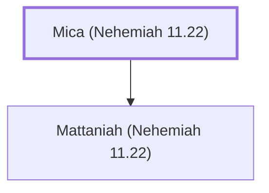

# Mica (Nehemiah 11.22)

A Levite leader in Jerusalem after the exile.

**Also called:** Micaiah

**Original-language names:** מִיכָא (H4316) · מִיכָיָה (H4320)

## When

- **Placed around:** [[connections/timeline/5th century BC|445 BC]] *(Ussher: the median date of the passages naming them)*

## Family

- **Children:** [[connections/people/Mattaniah (Nehemiah 11.22)|Mattaniah (Nehemiah 11.22)]]

**Family group:** [[connections/genealogy/Family of Mica (Nehemiah 11.22)|Family of Mica (Nehemiah 11.22)]], generation 1

## Appears in

[[connections/chapters/16-nehemiah/Nehemiah 11|Nehemiah 11]] · [[connections/chapters/16-nehemiah/Nehemiah 12|Nehemiah 12]]

## Appears in the same verse as

[[connections/people/Asaph (1 Chronicles 6.24)|Asaph (1 Chronicles 6.24) (2)]] · [[connections/people/Mattaniah (Nehemiah 11.22)|Mattaniah (Nehemiah 11.22) (2)]] · [[connections/people/Bani (Nehemiah 11.22)|Bani (Nehemiah 11.22)]] · [[connections/people/Hashabiah (Nehemiah 11.22)|Hashabiah (Nehemiah 11.22)]] · [[connections/people/Jonathan (Nehemiah 12.35)|Jonathan (Nehemiah 12.35)]] · [[connections/people/Shemaiah (Nehemiah 12.35)|Shemaiah (Nehemiah 12.35)]] · [[connections/people/Uzzi (Nehemiah 11.22)|Uzzi (Nehemiah 11.22)]] · [[connections/people/Zaccur (1 Chronicles 25.2)|Zaccur (1 Chronicles 25.2)]] · [[connections/people/Zechariah (Nehemiah 12.35)|Zechariah (Nehemiah 12.35)]] · [[connections/places/Jerusalem|Jerusalem]]
