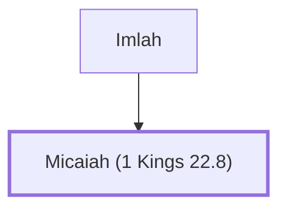

# Micaiah (1 Kings 22.8)

A prophet who foretold King Ahab's death.

**Also called:** Micahu

**Original-language names:** מִיכָֽיְהוּ (H4321) · מִיכָהוּ (H4319) · מִיכָה (H4318)

## When

- **Placed around:** [[connections/timeline/9th century BC|897 BC]] *(Ussher: the median date of the passages naming them)*

## Family

- **Father:** [[connections/people/Imlah|Imlah]]

**Family group:** [[connections/genealogy/Family of Imlah|Family of Imlah]], generation 2

## Appears in

[[connections/chapters/11-1-kings/1 Kings 22|1 Kings 22 (9)]] · [[connections/chapters/14-2-chronicles/2 Chronicles 18|2 Chronicles 18 (9)]]

## Appears in the same verse as

[[connections/people/Israel|Israel (6)]] · [[connections/people/Imlah|Imlah (4)]] · [[connections/people/Amon (1 Kings 22.26)|Amon (1 Kings 22.26) (2)]] · [[connections/people/Chenaanah (1 Kings 22.11)|Chenaanah (1 Kings 22.11) (2)]] · [[connections/people/Jehoshaphat (1 Kings 15.24)|Jehoshaphat (1 Kings 15.24) (2)]] · [[connections/people/Joash (1 Kings 22.26)|Joash (1 Kings 22.26) (2)]] · [[connections/people/Zedekiah (1 Kings 22.11)|Zedekiah (1 Kings 22.11) (2)]] · [[connections/places/Ramoth|Ramoth (2)]]
