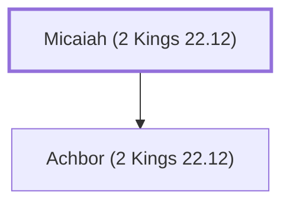

# Micaiah (2 Kings 22.12)

A Levite sent by King Josiah to inquire of the Lord.

**Also called:** Micah

**Original-language names:** מִיכָיָה (H4320) · מִיכָה (H4318)

## When

- **Placed around:** [[connections/timeline/7th century BC|624 BC]] *(Ussher: the median date of the passages naming them)*

## Family

- **Children:** [[connections/people/Achbor (2 Kings 22.12)|Achbor (2 Kings 22.12)]]

**Family group:** [[connections/genealogy/Family of Micaiah (2 Kings 22.12)|Family of Micaiah (2 Kings 22.12)]], generation 1

## Appears in

[[connections/chapters/12-2-kings/2 Kings 22|2 Kings 22]] · [[connections/chapters/14-2-chronicles/2 Chronicles 34|2 Chronicles 34]]

## Appears in the same verse as

[[connections/people/Achbor (2 Kings 22.12)|Achbor (2 Kings 22.12) (2)]] · [[connections/people/Ahikam|Ahikam (2)]] · [[connections/people/Asaiah (2 Kings 22.12)|Asaiah (2 Kings 22.12) (2)]] · [[connections/people/Hilkiah (2 Kings 22.4)|Hilkiah (2 Kings 22.4) (2)]] · [[connections/people/Shaphan (2 Kings 22.3)|Shaphan (2 Kings 22.3) (2)]]
