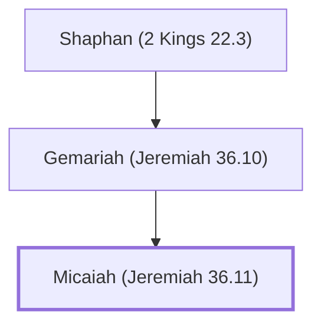

# Micaiah (Jeremiah 36.11)

Son of Gemariah, reported Baruch's reading of Jeremiah's scroll.

**Original-language names:** מִיכָֽיְהוּ (H4321)

## When

- **Placed around:** [[connections/timeline/7th century BC|606 BC]] *(Ussher: the median date of the passages naming them)*

## Family

- **Father:** [[connections/people/Gemariah (Jeremiah 36.10)|Gemariah (Jeremiah 36.10)]]

**Line of descent** (5 generations, father to son): [[connections/people/Meshullam (2 Kings 22.3)|Meshullam (2 Kings 22.3)]] → [[connections/people/Azaliah|Azaliah]] → [[connections/people/Shaphan (2 Kings 22.3)|Shaphan (2 Kings 22.3)]] → [[connections/people/Gemariah (Jeremiah 36.10)|Gemariah (Jeremiah 36.10)]] → **Micaiah (Jeremiah 36.11)**

**Family group:** [[connections/genealogy/Family of Meshullam (2 Kings 22.3)|Family of Meshullam (2 Kings 22.3)]], generation 5

## Appears in

[[connections/chapters/24-jeremiah/Jeremiah 36|Jeremiah 36 (2)]]

## Appears in the same verse as

[[connections/people/Baruch (Jeremiah 32.12)|Baruch (Jeremiah 32.12)]] · [[connections/people/Gemariah (Jeremiah 36.10)|Gemariah (Jeremiah 36.10)]] · [[connections/people/Shaphan (2 Kings 22.3)|Shaphan (2 Kings 22.3)]]
