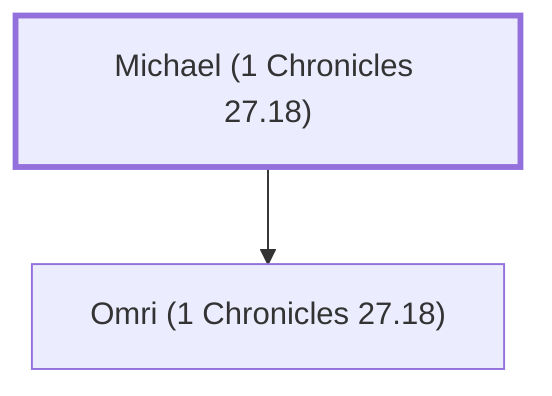

# Michael (1 Chronicles 27.18)

A leader of the tribe of Issachar under David.

**Original-language names:** מִיכָאֵל (H4317)

## When

- **Placed around:** [[connections/timeline/11th century BC|1015 BC]] *(Ussher: the median date of the passages naming them)*

## Family

- **Children:** [[connections/people/Omri (1 Chronicles 27.18)|Omri (1 Chronicles 27.18)]]

**Family group:** [[connections/genealogy/Family of Michael (1 Chronicles 27.18)|Family of Michael (1 Chronicles 27.18)]], generation 1

## Appears in

[[connections/chapters/13-1-chronicles/1 Chronicles 27|1 Chronicles 27]]

## Appears in the same verse as

[[connections/people/David|David]] · [[connections/people/Elihu (1 Chronicles 27.18)|Elihu (1 Chronicles 27.18)]] · [[connections/people/Issachar (Genesis 30.18)|Issachar (Genesis 30.18)]] · [[connections/people/Judah (Genesis 29.35)|Judah (Genesis 29.35)]] · [[connections/people/Omri (1 Chronicles 27.18)|Omri (1 Chronicles 27.18)]]
