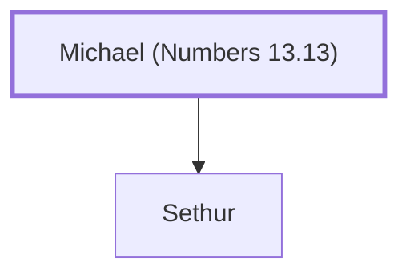

# Michael (Numbers 13.13)

A spy from the tribe of Asher.

**Original-language names:** מִיכָאֵל (H4317)

## When

- **Placed around:** [[connections/timeline/15th century BC|1490 BC]] *(Ussher: the median date of the passages naming them)*

## Family

- **Children:** [[connections/people/Sethur|Sethur]]

**Family group:** [[connections/genealogy/Family of Michael (Numbers 13.13)|Family of Michael (Numbers 13.13)]], generation 1

## Appears in

[[connections/chapters/04-numbers/Numbers 13|Numbers 13]]

## Appears in the same verse as

[[connections/people/Asher|Asher]] · [[connections/people/Sethur|Sethur]]
